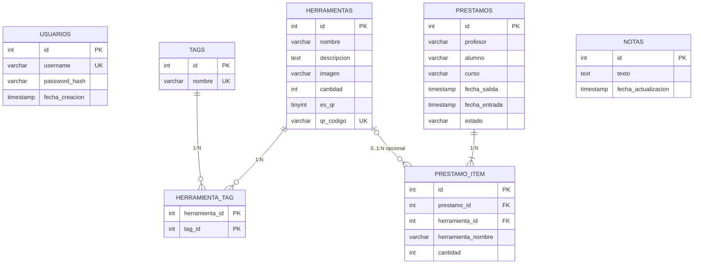

# README_TECNICO.md — Documentación técnica exhaustiva de C.D.H.I.

> **Qué es este documento.** Un recorrido completo, archivo por archivo, del sistema C.D.H.I. (Control Digitalizado de Herramientas e Insumos): una aplicación web Flask + MySQL para el pañol de una escuela técnica. Está escrito con enfoque pedagógico: cada archivo explica qué hace, por qué está hecho así y cómo se conecta con el resto.
>
> **Cobertura.** Se documentan los archivos fuente y de documentación del proyecto: archivos Python y configuración de la raíz, plantillas Jinja2 (`templates/`), scripts de frontend (`static/js/`), hojas de estilo (`static/css/`), recursos gráficos (`static/img/`) y el directorio de datos `registros/` (se documenta su contrato). También se describen los artefactos de documentación (`README.docx` y `README_TECNICO.md`) y el `.env` local **sin reproducir sus secretos**. `md_to_docx.py` está ausente en el checkout actual; su sección describe el propósito del generador como referencia histórica. No se documentan `venv/` ni `__pycache__/` porque son dependencias y artefactos generados por Python. También se documenta explícitamente lo que **no** existe (no hay `Dockerfile`, tests ni `package.json`).
>
> **Cómo leerlo.** Si es la primera vez que ves el proyecto: lee la sección 1 (arquitectura) y después ve archivo por archivo en el orden propuesto (raíz → plantillas → JS → CSS). Si ya conocés el proyecto: usá el índice por archivo; cada ficha tiene la misma estructura de 4 bloques: *Propósito e integración*, *Desglose técnico detallado* (con el porqué de cada decisión), *Flujo de datos y ejecución* y, cuando aporta, *Trampas y límites conocidos*.

---

## Índice general

1. [Arquitectura global del proyecto](#1-arquitectura-global-del-proyecto)
2. [Archivos raíz (backend y configuración)](#2-archivos-raíz-backend-y-configuración)
   - 2.1 [`config.py`](#21-configpy)
   - 2.2 [`db.py`](#22-dbpy)
   - 2.3 [`init_db.py`](#23-init_dbpy)
     - 2.3.1 [Modelo entidad-relación (MER)](#231-modelo-entidad-relación-mer)
   - 2.4 [`crear_usuario.py`](#24-crear_usuariopy)
   - 2.5 [`requirements.txt`](#25-requirementstxt)
   - 2.6 [`.env.example`](#26-envexample)
   - 2.7 [`README.md`](#27-readmemd)
   - 2.8 [`app.py`](#28-apppy)
   - 2.9 [`md_to_docx.py` y artefactos Word](#29-md_to_docxpy-y-artefactos-word)
3. [Plantillas Jinja2 (`templates/`)](#3-plantillas-jinja2-templates)
   - 3.1 [`templates/base.html`](#31-templatesbasehtml)
   - 3.2 [`templates/login.html`](#32-templatesloginhtml)
   - 3.3 [`templates/index.html`](#33-templatesindexhtml)
   - 3.4 [`templates/gestionar-herramientas.html`](#34-templatesgestionar-herramientashtml)
4. [JavaScript del frontend (`static/js/`)](#4-javascript-del-frontend-staticjs)
   - 4.1 [`static/js/notificaciones.js`](#41-staticjsnotificacionesjs)
   - 4.2 [`static/js/auth.js`](#42-staticjsauthjs)
   - 4.3 [`static/js/login.js`](#43-staticjsloginjs)
   - 4.4 [`static/js/qr-scanner.js`](#44-staticjsqr-scannerjs)
   - 4.5 [`static/js/herramientas.js`](#45-staticjsherramientasjs)
   - 4.6 [`static/js/movimientos.js`](#46-staticjsmovimientosjs)
   - 4.7 [`static/js/notas.js`](#47-staticjsnotasjs)
   - 4.8 [`static/js/escaneo-carrito.js`](#48-staticjsescaneo-carritojs)
   - 4.9 [`static/js/gestionar-herramientas.js`](#49-staticjsgestionar-herramientasjs)
5. [Hojas de estilo (`static/css/`)](#5-hojas-de-estilo-staticcss)
   - 5.1 [`static/css/notificaciones.css`](#51-staticcssnotificacionescss)
   - 5.2 [`static/css/login.css`](#52-staticcsslogincss)
   - 5.3 [`static/css/index.css`](#53-staticcssindexcss)
   - 5.4 [`static/css/movimientos.css`](#54-staticcssmovimientoscss)
   - 5.5 [`static/css/gestionar-herramientas.css`](#55-staticcssgestionar-herramientascss)
6. [Recursos gráficos (`static/img/`)](#6-recursos-gráficos-staticimg)
7. [Directorio de datos `registros/`](#7-directorio-de-datos-registros)
8. [Contrato completo de la API](#8-contrato-completo-de-la-api)
9. [Flujos de ejecución de punta a punta](#9-flujos-de-ejecución-de-punta-a-punta)
10. [Decisiones transversales de seguridad](#10-decisiones-transversales-de-seguridad)
11. [Variables de entorno, middleware y archivos de configuración](#11-variables-de-entorno-middleware-y-archivos-de-configuración)
12. [Ausencias deliberadas (lo que el proyecto NO tiene)](#12-ausencias-deliberadas-lo-que-el-proyecto-no-tiene)
13. [Operación y despliegue](#13-operación-y-despliegue)
14. [Glosario](#14-glosario)

---

## 1. Arquitectura global del proyecto

### 1.1. Qué problema resuelve

C.D.H.I. digitaliza la operación diaria del pañol de una escuela técnica:

1. **Catálogo de herramientas** con imagen, stock, tags y (opcionalmente) un código QR que identifica objetos únicos (ej. un taladro específico) que no se controlan por cantidad sino por disponibilidad 0/1.
2. **Encargos (préstamos)**: un docente o alumno retira herramientas ("salida"); el sistema descuenta stock, registra quién, cuándo y qué; al devolverlas ("entrada") repone el stock. Todo queda en un log CSV diario descargable (para Excel/Sheets).
3. **Escaneo de QR** con la cámara del celular para identificar rápido objetos únicos.
4. **Bloc de notas compartido** del pañol.
5. **Autenticación** con usuario/contraseña y sesiones firmadas por cookie.

### 1.2. Stack tecnológico y por qué

| Capa | Tecnología | Por qué se eligió (según se desprende de las decisiones del código) |
|---|---|---|
| Backend | **Python 3 + Flask 3** | Framework minimalista: un único proceso sirve páginas Jinja2 **y** API REST. Sin ORM ni capas extra: para un pañol escolar, la simplicidad operativa pesa más que la escalabilidad. |
| Base de datos | **MySQL 8 / MariaDB (InnoDB, utf8mb4)** | Motor relacional disponible en cualquier servidor Linux (en producción, Debian 12); InnoDB da transacciones reales, claves foráneas y bloqueos `FOR UPDATE` (necesarios para el control de stock concurrente). |
| Acceso a datos | **PyMySQL + adaptador propio** (`db.py`) | Driver puro Python (se instala con pip, sin compilar). `db.py` lo envuelve para imitar la API de `sqlite3` (`conn.execute(...).fetchone()`), lo que mantiene `app.py` corto y legible. |
| Frontend | **HTML + CSS + JS vanilla** | Sin build step, sin npm, sin frameworks: cualquiera puede editar un `.js` y recargar. Las funciones se comunican por variables globales (`carrito`, `herramientasCache`, `mostrarAlerta`). |
| Librerías de frontend | **`<model-viewer>` (Google) y `html5-qrcode` (unpkg)** | Se cargan por CDN; el logo 3D (`.gltf`) y el lector QR funcionan sin empaquetado. |
| Producción | **Gunicorn + Apache 2 + systemd (Debian 12)** | Apache ya está en el server de la escuela; Gunicorn corre solo en `127.0.0.1:5000` con 2 workers (1 GB de RAM) y Apache hace de proxy inverso con HTTPS. |

### 1.3. Mapa de capas y comunicación

```
Navegador (celular / PC de escritorio)
│
│  HTML (Jinja2)         fetch() → JSON / multipart / CSV / ZIP
▼
Flask (app.py)  ──── render_template ───►  templates/*.html ──► static/css/*.css
│                                           │
│  sesión (cookie firmada con SECRET_KEY)   └──► static/js/*.js  (consumen la API)
▼
db.py (context manager db(): 1 conexión MySQL por request, transacción commits/rollback)
│
▼
MySQL (esquema creado por init_db.py; usuarios creados por crear_usuario.py)

Efectos secundarios en disco:
  registros/AAAA-MM-DD.csv   ← log diario de movimientos (escribir_log)
  static/img/                ← imágenes subidas vía /api/upload-imagen
```

**Reglas de comunicación entre módulos (importantes para entender todo lo demás):**

- `app.py` es el **único** módulo del backend que conoce la web: importa `SECRET_KEY` de `config.py` y `db` de `db.py`. Nada importa a `app.py`.
- `config.py` es una hoja del grafo de imports: lo importan `app.py`, `db.py`, `init_db.py` y `crear_usuario.py`. Todos leen las mismas credenciales/secretos de variables de entorno.
- `init_db.py` y `crear_usuario.py` son **scripts de administración de un solo uso** (se ejecutan a mano), no se importan desde la app.
- El frontend **no tiene build**: cada página Jinja2 declara qué scripts carga y en qué orden; los módulos JS se comunican por variables y funciones globales (`window.APP`, `window.mostrarAlerta`, `window.esMovil`, `window.abrirEscaneoQR`, `carrito`, `herramientasCache`). Los `typeof x !== "undefined"` que verás en el JS son exactamente para tolerar el orden de carga.
- `base.html` inyecta `window.APP` (URL base de estáticos + nombre de usuario) para que ningún `.js` tenga rutas ni datos de servidor hardcodeados.

### 1.4. Convenciones transversales (aplican a todo el código)

1. **SQL siempre parametrizado** con placeholders `%s` de PyMySQL (nunca f-strings con datos). La única interpolación de texto en SQL es el nombre de la base en `init_db.py`, validado con regex antes de usarse.
2. **Transacciones explícitas**: `autocommit=False` y el context manager `db()` hace `COMMIT` si el bloque termina bien y `ROLLBACK` si lanza excepción. Las operaciones críticas (crear/devolver encargo, editar herramienta) además usan `SELECT ... FOR UPDATE` para bloquear filas.
3. **Anti-XSS de salida**: Jinja2 auto-escapa las plantillas; en el JS, todo dato que venga de la base se inserta con `textContent`/`createTextNode`, nunca con `innerHTML`.
4. **Anti-CSRF básico**: cookies `SameSite=Lax` + todos los `fetch()` del frontend usan `credentials: "same-origin"`. No hay token CSRF (ver sección 10).
5. **Validación en el borde**: cada endpoint valida tipos, largos y rangos *antes* de tocar la base; los helpers (`texto_de`, `entero_en_rango`, `parse_tags`, `leer_es_qr`) centralizan esas reglas para que crear y editar herramienta se comporten igual.
6. **Mensajes de error en español, accionables para el usuario** (ej. "Stock insuficiente para Martillo"), y códigos HTTP correctos (400/401/404/409/410/413/500) para que el frontend sepa qué hacer.
7. **Deuda técnica explícita**: cuando algo se retiró, se dejó un endpoint que responde `410 Gone` (`POST /api/movimientos`) y comentarios que explican por qué, en vez de borrar silenciosamente.

### 1.5. Recorrido de un request típico (ejemplo: registrar una salida)

1. El operador arma el carrito en `index.html` (JS: `movimientos.js` + `herramientas.js`).
2. `registrarSalida()` hace `fetch POST /api/prestamos` con JSON `{profesor, alumno, curso, items:[{herramienta_id, cantidad}]}` y la cookie de sesión.
3. En Flask, `crear_prestamo` (en `app.py`) verifica sesión (`@login_required_api`), valida tipos, consolida items repetidos, y dentro de una transacción de `db()` bloquea cada herramienta (`FOR UPDATE`), valida stock, inserta `prestamos` + `prestamo_item`, y descuenta stock con `UPDATE` condicionales.
4. Al commitear, `escribir_log("SALIDA", ...)` agrega filas al CSV del día en `registros/`.
5. La respuesta `201 {ok, id}` vuelve al JS, que limpia el carrito, refresca la grilla y los encargos pendientes, y muestra una notificación (`notificaciones.js`).

Con ese mapa mental, cada archivo de las siguientes secciones encaja como una pieza concreta.

---

## 2. Archivos raíz (backend y configuración)

### 2.1. `config.py`

**Propósito e integración.**
Es la **fuente única de configuración** del backend. Lee variables de entorno (de un archivo `.env` en desarrollo o del entorno real en producción) y las expone como constantes: `SECRET_KEY`, `MYSQL_HOST`, `MYSQL_PORT`, `MYSQL_USER`, `MYSQL_PASSWORD`, `MYSQL_DB`. Lo importan `app.py` (para la `SECRET_KEY` de las sesiones), `db.py` (para cada conexión MySQL), `init_db.py` y `crear_usuario.py` (para conectarse a la base). No importa a nadie: es una hoja del grafo de dependencias.

**Desglose técnico detallado.**

- **Dependencias**: `os` (leer entorno) y `dotenv.load_dotenv` (cargar `.env`). `load_dotenv()` se ejecuta al importar el módulo: busca un archivo `.env` en el directorio actual y carga sus claves *sin pisar* variables ya presentes en el entorno. Ese matiz es clave: en producción con systemd (`EnvironmentFile=...`) las variables reales del sistema ganan sobre cualquier `.env`, y en desarrollo funciona el `.env`.
- **`SECRET_KEY`**: se lee, se hace `.strip()` y, si queda vacía, se lanza `RuntimeError` con instrucciones paso a paso (copiar `.env.example`, generar la clave con `secrets.token_hex(32)`). Es un **fail-fast**: la app no arranca sin secreto, en vez de arrancar con una clave insegura o fallar recién al primer login.
- **`MYSQL_HOST`**: default `"127.0.0.1"` (se usa IP y no `localhost` para forzar TCP y evitar la ambigüedad de sockets Unix en Linux).
- **`MYSQL_PORT`**: se convierte a `int` dentro de un `try/except ValueError` que relanza un `RuntimeError` legible; después se valida `1 <= puerto <= 65535`. Es decir: un puerto mal escrito rompe el arranque con un mensaje claro, no con un error de conexión críptico.
- **`MYSQL_USER`**: default `"cdhi"`. **`MYSQL_PASSWORD`**: default `""` (vacío; la contraseña real debe venir del `.env`, nunca del código). **`MYSQL_DB`**: default `"cdhi"`.

**Flujo de datos y ejecución.**

- **Entra**: variables de entorno (`SECRET_KEY`, `MYSQL_*`) o el archivo `.env`.
- **Procesa**: valida presencia de la clave, convierte y valida el puerto, aplica defaults.
- **Sale**: seis constantes a nivel de módulo que el resto del backend importa; o una excepción `RuntimeError` que aborta el arranque si algo falta/está mal.

**El porqué de las decisiones.** Centralizar aquí evita que credenciales dupliquen en cuatro archivos; el patrón (12-factor: config en entorno) permite desplegar el mismo código en local y en el VPS cambiando solo el `.env`/entorno; y el fail-fast convierte errores de configuración (los más comunes en el primer despliegue) en mensajes autoexplicativos.

### 2.2. `db.py`

**Propósito e integración.**
Es la **capa de acceso a MySQL**. Expone `get_connection()` (conexión cruda) y, sobre todo, el context manager `db()` que usa `app.py` en cada endpoint con el patrón `with db() as conn: conn.execute(...)`. Depende de `config.py` (credenciales) y de `pymysql`. Convierte PyMySQL en algo que se usa casi igual que `sqlite3`, que es lo que el resto del código asume.

**Desglose técnico detallado.**

- **Clase `Cursor(pymysql.cursors.DictCursor)`**: define un único método, `execute(self, query, args=None)`, que ejecuta la consulta del padre y **devuelve `self`**. ¿Por qué? En PyMySQL, `cursor.execute()` devuelve el número de filas afectadas (un `int`), así que `conn.execute(...).fetchone()` fallaría. Al devolver el cursor, `app.py` puede encadenar: `cur = conn.execute("INSERT ...")` y luego usar `cur.lastrowid`, o `conn.execute("SELECT ...").fetchone()` y recibir un diccionario (herencia de `DictCursor`: cada fila es un `dict` con los nombres de columna como claves, p. ej. `fila["nombre"]`).
- **`get_connection()`**: abre una conexión nueva por llamada. Parámetros: `host/port/user/password/database` desde `config`, `charset="utf8mb4"` (acentos, eñes y emoji sin corromperse), `cursorclass=Cursor`, `autocommit=False` (transacciones explícitas: nada se guarda hasta el `commit()`), `connect_timeout=5` (si MySQL no responde, el request falla en 5 s con error de conexión en vez de colgarse).
- **`db()` (decorado con `@contextmanager`)**: entrega el cursor, y garantiza el ciclo de vida completo:
  1. Crea conexión y `cur = conn.cursor()`.
  2. `yield cur` — aquí corre el bloque del endpoint.
  3. Si el bloque termina bien → `conn.commit()`.
  4. Si lanza cualquier excepción → `conn.rollback()` y `raise` (la excepción no se traga: sube para que Flask devuelva 500 o para que el endpoint la maneje, como hace `crear_prestamo` con `RuntimeError` → 409).
  5. `finally`: cierra cursor y conexión **siempre**, haya commit, rollback o excepción de cierre.

**El porqué de las decisiones.**

- El docstring deja constancia de la decisión de **no usar pool de conexiones**: "suficiente para un pañol escolar; si escala, migrar a SQLAlchemy con pool". Un request = una conexión = un ciclo de vida trivial de razonar y sin conexiones huérfanas.
- Imitar la API de `sqlite3` en vez de reescribir `app.py` con la API nativa de PyMySQL reduce drásticamente el tamaño y la superficie de error del backend.
- El commit/rollback automático es lo que permite escribir operaciones multi-tabla (préstamo + items + descuento de stock) sin olvidarse nunca del rollback en cada `return` de error.

**Flujo de datos y ejecución.**

- **Entra**: sentencias SQL con placeholders `%s` y tuplas de parámetros.
- **Procesa**: apertura de conexión TCP a MySQL, ejecución dentro de una transacción, aplicación del commit o rollback según el resultado del bloque.
- **Sale**: filas como diccionarios (`fetchone`/`fetchall`), `lastrowid`/`rowcount` para escrituras, y la certeza de que la transacción quedó cerrada y la conexión devuelta al SO.

**Trampas y límites conocidos.** No hay reintentos ni pool; una latencia alta de MySQL se traduce directamente en latencia del request (mitigado con `connect_timeout=5`). El commit se hace incluso en bloques de solo lectura (costo mínimo, transacción vacía).

### 2.3. `init_db.py`

**Propósito e integración.**
Script **manual** (`python init_db.py`) que crea la base de datos, todo el esquema en MySQL y aplica una migración idempotente del detalle de préstamos. Se ejecuta en la primera instalación y también después de actualizar el código cuando cambia el esquema; no está pensado para correr en cada arranque de la app. Es la fuente de verdad del modelo de datos que `app.py` consulta y que la documentación por tablas de esta sección describe. Importa credenciales de `config.py` y usa PyMySQL directo (sin pasar por `db.py`, porque necesita conectarse *sin* base seleccionada para poder crearla). No lo importa nadie.

**Desglose técnico detallado.**

- **Validación previa del nombre de base**: `re.fullmatch(r"[A-Za-z0-9_]+", MYSQL_DB)`; si no cumple, `sys.exit(...)`. El porqué es explícito en un comentario: un identificador SQL (nombre de base) **no se puede parametrizar** con `%s`; al interpolarse con f-strings, la única defensa es validarlo contra un patrón estricto (letras, números, guion bajo). Así se cierra la puerta a inyección SQL por variable de entorno `MYSQL_DB`.
- **Conexión administrativa**: `pymysql.connect(...)` **sin** `database=`, con `autocommit=True` (cada DDL se aplica y persiste al instante; en MySQL el DDL además provoca commits implícitos). `charset="utf8mb4"`.
- **`ESQUEMA`**: una cadena multilínea con todas las sentencias `CREATE TABLE IF NOT EXISTS`, ejecutadas una por una tras partir la cadena por `;` (el esquema no contiene `;` dentro de strings, supuesto válido y comentado en el flujo). El uso de `IF NOT EXISTS` hace el script idempotente: correrlo dos veces no falla.
- **`migrar_prestamo_item(cur)`**: la única migración de datos/estructura del proyecto, y una lección de cómo evolucionar un esquema sin framework. Se ejecuta **siempre** después de crear las tablas y hace, en orden:
  1. `SHOW COLUMNS FROM prestamo_item LIKE 'herramienta_nombre'`; si la columna no existe, la agrega como `VARCHAR(100) NULL`.
  2. `UPDATE ... JOIN herramientas` para copiar el nombre actual de cada herramienta a las filas históricas que tengan `herramienta_nombre` nulo. Este paso es el que **preserva el historial**: a partir de ahora el detalle del encargo guarda su propio nombre y no depende de que la herramienta siga existiendo.
  3. `ALTER TABLE ... MODIFY herramienta_nombre VARCHAR(100) NOT NULL`, una vez que todas las filas tienen valor.
  4. Consulta `information_schema.KEY_COLUMN_USAGE` + `REFERENTIAL_CONSTRAINTS` para descubrir el nombre real y la regla `DELETE_RULE` de la FK de `herramienta_id` (el nombre puede variar entre instalaciones). Si ya hay **una sola** FK con `SET NULL` y la columna ya es `NULL`, retorna sin tocar nada (idempotencia).
  5. Si no, elimina todas las FK viejas de esa columna (con el nombre escapado entre backticks y duplicando los backticks internos), cambia `herramienta_id` a `INT NULL` y crea `fk_prestamo_item_herramienta ... ON DELETE SET NULL`.
  El porqué del diseño: `CREATE TABLE IF NOT EXISTS` no modifica tablas existentes; sin esta función, una base creada con la versión anterior seguiría con `herramienta_id NOT NULL` y sin `herramienta_nombre`, y el nuevo borrado de herramientas fallaría. La función es **idempotente** (se puede correr varias veces) y **conserva datos** (no borra ni recrea la tabla).
- **Modelo de datos completo** (este es el contrato real de la base):

| Tabla | Columnas y claves | Por qué |
|---|---|---|
| `usuarios` | `id` INT PK autoincremental; `username` VARCHAR(50) NOT NULL **UNIQUE**; `password_hash` VARCHAR(255) NOT NULL; `fecha_creacion` TIMESTAMP default CURRENT_TIMESTAMP | UNIQUE en `username` evita usuarios duplicados a nivel motor (además del chequeo en `crear_usuario.py`). El hash vive aquí, nunca la contraseña. |
| `herramientas` | `id` PK; `nombre` VARCHAR(100) NOT NULL; `descripcion` TEXT; `imagen` VARCHAR(255) NOT NULL DEFAULT `'martillo.png'`; `cantidad` INT NOT NULL DEFAULT 0; `es_qr` TINYINT NOT NULL DEFAULT 0; `qr_codigo` VARCHAR(100) NULL; `INDEX idx_qr (es_qr, qr_codigo)`; `UNIQUE INDEX ux_qr_codigo (qr_codigo)` | `es_qr` distingue cantidad-controlada (0) de objeto único (1). La UNIQUE sobre `qr_codigo` es la garantía dura de "un QR = una herramienta" (la API además devuelve 409 amistoso antes de violarla). El índice compuesto acelera la búsqueda `WHERE es_qr = 1 AND qr_codigo = ?`. La `imagen` guarda solo el **nombre de archivo** (la carpeta la resuelve el código). |
| `tags` | `id` PK; `nombre` VARCHAR(50) NOT NULL UNIQUE | Tabla de tags normalizada y compartida entre herramientas (el mismo tag "Manual" no se duplica por herramienta). |
| `herramienta_tag` | PK compuesta (`herramienta_id`, `tag_id`); FKs a `herramientas` y `tags` **ON DELETE CASCADE** | Relación N:M. La PK compuesta impide pares duplicados; el CASCADE hace que borrar una herramienta (o un tag) limpie sola la tabla puente, sin código extra. |
| `prestamos` | `id` PK; `profesor` VARCHAR(100) NOT NULL; `alumno` VARCHAR(100) NULL; `curso` VARCHAR(50) NULL; `fecha_salida` TIMESTAMP default CURRENT_TIMESTAMP; `fecha_entrada` TIMESTAMP NULL; `estado` VARCHAR(20) NOT NULL DEFAULT `'pendiente'`; `INDEX idx_estado` | Un encargo = una fila. `estado` (`pendiente`/`devuelto`) como texto legible + índice para el filtro `?estado=`. `fecha_entrada` NULL mientras no se devuelva. |
| `prestamo_item` | `id` PK; `prestamo_id` FK → `prestamos` **ON DELETE CASCADE**; `herramienta_id` INT **NULL** FK → `herramientas` **ON DELETE SET NULL**; `herramienta_nombre` VARCHAR(100) **NOT NULL**; `cantidad` INT NOT NULL | Detalle N:M de un encargo. El **cascade asimétrico es intencional**: borrar un encargo borra sus items; borrar una herramienta **no** borra el historial, deja `herramienta_id = NULL` y conserva el nombre en `herramienta_nombre`. Esa columna es una **foto del nombre al momento del préstamo**, no una copia viva: si mañana se renombra la herramienta, el encargo viejo sigue mostrando cómo se llamaba entonces. |
| `notas` | `id` INT PK (siempre 1); `texto` TEXT NOT NULL; `fecha_actualizacion` TIMESTAMP default CURRENT_TIMESTAMP **ON UPDATE CURRENT_TIMESTAMP** | Bloc compartido modelado como fila única fija `id=1`; el `ON UPDATE` mantiene la fecha de última edición sin código SQL adicional. |

#### 2.3.1. Modelo entidad-relación (MER)

**Diagrama completo (una sola imagen).** El MER se dibuja con Mermaid `erDiagram`: las 7 tablas en un mismo gráfico, cada FK como línea y la cardinalidad en los símbolos de los extremos y en la etiqueta de la relación. `USUARIOS` y `NOTAS` están incluidas; no tienen FK, por eso quedan sin línea.



**Cardinalidades.**

| Relación | Cardinalidad | Lectura |
|---|---|---|
| `HERRAMIENTAS` → `HERRAMIENTA_TAG` | 1:N | Una herramienta puede tener cero o muchos tags; cada fila puente apunta a una sola herramienta. |
| `TAGS` → `HERRAMIENTA_TAG` | 1:N | Un tag puede estar en cero o muchas herramientas; cada fila puente apunta a un solo tag. |
| `HERRAMIENTAS` ↔ `TAGS` (conjunto) | N:M | Es la relación que implementa la tabla puente: muchos tags por herramienta y muchas herramientas por tag. |
| `PRESTAMOS` → `PRESTAMO_ITEM` | 1:N | Un encargo tiene uno o más ítems; cada ítem pertenece a un solo encargo. |
| `HERRAMIENTAS` → `PRESTAMO_ITEM` | 0..1:N | Cada ítem puede apuntar a cero o una herramienta (si se borró, `herramienta_id = NULL`); una herramienta puede aparecer en muchos ítems históricos. |
| `USUARIOS` | Sin relación | No hay FK hacia `prestamos`; solo se usa para el login. |
| `NOTAS` | Sin relación | Singleton `id = 1`; no tiene FK. |

**Cómo se lee la cardinalidad.** En Mermaid, `||` = exactamente 1; `o|` = 0 o 1; `|{` = 1 o más; `o{` = 0 o más. La etiqueta de cada relación repite la razón (`1:N`, `0..1:N`) para que no dependa solo del símbolo. La tabla puente `herramienta_tag` implementa el N:M; `prestamo_item.herramienta_id` queda en `NULL` si se borra la herramienta, y `herramienta_nombre` conserva el nombre histórico.

En `HERRAMIENTAS o|--o{ PRESTAMO_ITEM`, el `0..1` se lee **desde el ítem hacia la herramienta**: cada `PRESTAMO_ITEM` puede apuntar a cero o una herramienta (cero si se borró, una si sigue existiendo). El `N` se lee **desde la herramienta hacia los ítems**: una herramienta puede aparecer en muchos ítems históricos. No significa que una herramienta tenga 0..1 ítems; si la FK fuera obligatoria, la relación sería `1:N`.

GitHub/GitLab renderizan el bloque Mermaid; para Word hay que exportar el diagrama como PNG/SVG desde <https://mermaid.live>, porque `md_to_docx.py` no interpreta Mermaid.

**Decisiones del modelo (el porqué).**

- **Tabla puente explícita** (`herramienta_tag`) en vez de un campo `tags` con texto separado por comas: permite índices, integridad referencial, renombrar un tag una sola vez y consultar `GROUP_CONCAT` sin duplicar filas. El costo es una tabla más y el patrón borrar-y-reinsertar de `guardar_tags`.
- **`prestamo_item` con PK propia** (`id`) y no PK compuesta (`prestamo_id`, `herramienta_id`): un mismo encargo puede repetir la misma herramienta en dos líneas (aunque `crear_prestamo` consolida), y la PK subrogada simplifica el `DELETE`/`UPDATE`. Conceptualmente es una **entidad débil** de `prestamos`: su ciclo de vida depende del encargo (`ON DELETE CASCADE`).
- **Nombre histórico en el detalle**: `herramienta_nombre` desnormaliza a propósito. Es la única forma de que borrar una herramienta no destruya la trazabilidad del encargo; el precio es que un rename posterior no actualiza los encargos viejos (se guarda la foto del momento, no el nombre vivo).
- **`herramienta_id` nullable**: materializa la relación opcional que deja `ON DELETE SET NULL`. Sin ella, borrar una herramienta obligaría a borrar su historial o a bloquear el borrado (la regla anterior, que se cambió en esta versión).
- **`notas` como singleton**: un pañol tiene un solo bloc; modelarlo con `id=1` evita una tabla de "notas por usuario" y hace la escritura atómica. La alternativa (una fila por nota) exigiría orden, autor y merge, complejidad que el caso de uso no pide.

- **Fila fija del bloc**: `INSERT IGNORE INTO notas (id, texto) VALUES (1, '')`. El porqué: `PUT /api/notas` actualiza la fila existente (no hace UPSERT); garantizar la fila 1 desde la creación del esquema simplifica el endpoint y evita un caso especial "primera vez".
- **Todas las tablas con `ENGINE=InnoDB` y `DEFAULT CHARSET=utf8mb4 COLLATE=utf8mb4_unicode_ci`**: InnoDB es requisito de las FK y de `FOR UPDATE`; utf8mb4_unicode_ci da ordenamiento y comparación correctos para español.
- **Mensaje final** `print("Base de datos lista en MySQL: ...")` y `finally: conn.close()`: el script siempre cierra la conexión.

**Flujo de datos y ejecución.**

- **Entra**: credenciales de `config.py`/entorno y el SQL embebido en `ESQUEMA`.
- **Procesa**: valida el nombre de base → conecta como usuario administrador → `CREATE DATABASE IF NOT EXISTS ... CHARACTER SET utf8mb4 COLLATE utf8mb4_unicode_ci` → `USE` → crea las 7 tablas → ejecuta `migrar_prestamo_item` → siembra la fila de notas.
- **Sale**: base de datos lista (y actualizada) para que `app.py` y `crear_usuario.py` la usen; imprime confirmación por consola. En producción se corre con un usuario con permisos DDL (idealmente root de MySQL) y luego la app usa un usuario sin DDL (ver `README.md`).

**Trampas y límites conocidos.** `CREATE TABLE IF NOT EXISTS` **no** migra esquemas por sí solo: si una tabla ya existe con columnas viejas, no la altera. La excepción es `migrar_prestamo_item`, una migración puntual y escrita a mano para el cambio `herramienta_id` + `herramienta_nombre`; cualquier cambio futuro necesita una función equivalente. No hay framework de migraciones (Alembic, Flyway) ni tabla de versiones: el programador debe escribir migraciones idempotentes y ejecutar `init_db.py` (o el `ALTER TABLE` equivalente) de forma consciente. Además, el script conecta **sin** base y hace `CREATE DATABASE`; por eso en producción no se ejecuta como usuario de la app (ver sección 13).

### 2.4. `crear_usuario.py`

**Propósito e integración.**
Script manual de alta de usuarios (`python crear_usuario.py`), pensado para ejecutarse en el servidor/terminal. Es la **única** vía de creación de cuentas: no existe endpoint de registro en la API (decisión de seguridad: nadie se auto-registra desde la web). Escribe en la tabla `usuarios` que `app.py` consultará en `/api/login`. Importa credenciales de `config.py`, y las funciones de hash de Werkzeug (`generate_password_hash`) — el mismo formato que `app.py` verifica con `check_password_hash`.

**Desglose técnico detallado.**

- **Entrada de datos con `input()` para el usuario y `getpass.getpass()` doble para la contraseña**. `getpass` es el porqué evidente: la contraseña no se muestra ni queda en el historial de la terminal; se pide dos veces para detectar typos (la misma razón que cualquier pantalla de registro).
- **Validaciones, en orden, con `sys.exit(mensaje)`** (mensaje directo, sin crear nada): usuario y contraseña no vacíos; usuario ≤ 50 caracteres (calza con `VARCHAR(50)`); las dos contraseñas coinciden; contraseña ≥ 8 caracteres (política mínima). Todas se hacen **antes** de abrir la conexión: no tiene sentido tocar la base para rechazar input.
- **Conexión propia** (no usa `db()`): `pymysql.connect(... database=MYSQL_DB, charset="utf8mb4", cursorclass=pymysql.cursors.DictCursor)` — el `DictCursor` aquí solo se aprovecha para leer `existente` como dict. Sin `autocommit`: el script controla el `conn.commit()` explícito.
- **Chequeo anti-duplicado explícito**: `SELECT id FROM usuarios WHERE username = %s`; si existe, `sys.exit("Ya existe un usuario...")`. Aunque la tabla tiene UNIQUE (el insert duplicado fallaría igual con un error críptico), este chequeo da un mensaje humano. Nota: hay una micro-carrera entre el SELECT y el INSERT, irrelevante para un script manual.
- **Hash de contraseña**: `generate_password_hash(password)`. Werkzeug genera un string autocontenido con el formato `método:parámetros$sal$hash` (con Werkzeug moderno el método por defecto es **scrypt**; versiones anteriores usaban **PBKDF2**, que es lo que menciona el docstring). La clave pedagógica: **el algoritmo y la sal viajan dentro del propio hash**, así que `check_password_hash` en el login no necesita saber con qué se generó cada contraseña — y cambiar el default de Werkzeug en el futuro no invalida usuarios viejos.
- **Commit explícito** tras el INSERT y `finally: conn.close()`.

**Flujo de datos y ejecución.**

- **Entra**: usuario y contraseña tipeados en la terminal.
- **Procesa**: valida formato y largos → busca duplicados → genera hash (nunca guarda la contraseña) → INSERT en `usuarios`.
- **Sale**: fila nueva en `usuarios` (commiteada) y mensaje "Usuario 'X' creado. Ya puede iniciar sesión en la web", o una salida temprana con error y **cero cambios**.

### 2.5. `requirements.txt`

**Propósito e integración.**
Declara las 5 dependencias Python con rangos de versión compatibles; es lo que instala `pip install -r requirements.txt` tanto en desarrollo como en el paso 3 del despliegue del `README.md`. Es la definición del entorno de ejecución del backend completo.

**Desglose técnico detallado (qué es cada dependencia y por qué está).**

- `Flask>=3.0,<4` — el framework web. El rango `<4` evita saltos de major con breaking changes; `>=3.0` habilita la sintaxis `@app.get/post/put/delete` usada en `app.py`.
- `PyMySQL>=1.1,<2` — driver MySQL puro Python, usado por `app.py` (vía `db.py`), `init_db.py` y `crear_usuario.py`.
- `cryptography>=42,<44` — **no se importa en ningún archivo**: es la dependencia que PyMySQL necesita para autenticarse con los plugins modernos de MySQL 8 (`caching_sha2_password`, el default del servidor, y `sha256_password`). Sin este paquete, la conexión falla con "cryptography package is required for sha256_password or caching_sha2_password auth methods". Está aquí precisamente para que nadie deba depurarlo.
- `python-dotenv>=1.0,<2` — lee el archivo `.env` (usado en `config.py`).
- `gunicorn>=22,<24` — servidor WSGI de producción (solo Linux/macOS). En Windows no corre: en desarrollo se usa `python app.py` (servidor de Flask), tal como documenta el `README.md`.

**Flujo de datos y ejecución.** No se ejecuta: es un manifiesto de instalación. Todas son dependencias directas (no hay `requirements-dev.txt` ni `pip-tools`; no hay hash pinning ni lockfile). El porqué probable: simplicidad para un proyecto escolar; el costo: dos instalaciones en fechas distintas pueden traer micro-versiones distintas.

### 2.6. `.env.example`

**Propósito e integración.**
Plantilla de configuración versionada en el repo. Es el contrato documentado entre `config.py` y quien despliega: cada variable que aparece aquí es leída por `config.py` o `app.py`, con comentarios de uso. Se copia con `cp .env.example .env` y se completa. `.env` está excluido de Git mediante `.gitignore`; solo se versiona esta plantilla. Los valores del `.env` no se reproducen en esta documentación.

**Desglose técnico detallado y el porqué de cada variable.**

- `SECRET_KEY=` — obligatoria; el comentario indica cómo generarla (`python -c "import secrets; print(secrets.token_hex(32))"`). Firma criptográficamente la cookie de sesión; si se filtra, un atacante puede falsificar sesiones; si cambia, todas las sesiones activas se invalidan (comportamiento aceptable y hasta deseable ante rotación de secreto).
- `MYSQL_HOST=127.0.0.1`, `MYSQL_PORT=3306`, `MYSQL_USER=cdhi`, `MYSQL_PASSWORD=`, `MYSQL_DB=cdhi` — credenciales de la base. `MYSQL_PASSWORD` se deja vacía a propósito: forzar el llenado manual evita desplegar con una contraseña de ejemplo.
- `PORT=5000` — **solo** lo usa el bloque `if __name__ == "__main__"` de `app.py` (servidor de desarrollo). En producción el puerto lo define Gunicorn (`--bind 127.0.0.1:5000` en el unit de systemd).
- `SESSION_COOKIE_SECURE=0` — con `0` la cookie viaja también por HTTP (necesario en desarrollo local, que no tiene TLS); en producción se pone `1` para que el navegador solo la envíe por HTTPS. `app.py` acepta `1/true/yes/on` como "activado".
- El encabezado advierte "Nunca subas `.env` al repositorio: tiene secretos" — la contramedida operativa es `chmod 600 .env` (paso 5 del despliegue) y mantenerlo fuera de cualquier copia pública.

**El `.env` real.** Es el archivo que `load_dotenv()` lee al importar `config.py`; contiene los mismos nombres que `.env.example` pero con valores reales (`SECRET_KEY`, contraseña de MySQL, etc.). En desarrollo convive localmente con el proyecto; en producción systemd lo inyecta con `EnvironmentFile=`. `.gitignore` evita que se agregue en commits futuros. Como el archivo estuvo versionado, quitarlo del seguimiento no elimina sus valores de los commits anteriores: se deben rotar la clave de sesión y la contraseña de MySQL. No se documentan sus valores.

### 2.7. `README.md`

**Propósito e integración.**
Es la guía **operativa** del proyecto (no la técnica; este documento es la técnica). Su audiencia es quien instala/despliega: instalación local y despliegue en producción sobre **Debian 12 bare-metal** (Gunicorn + Apache 2 + systemd + Certbot/Let's Encrypt + UFW + backups), tabla de variables de entorno, solución de problemas y checklist de seguridad. No lo ejecuta nadie; lo leen humanos. Se complementa con este `README_TECNICO.md`: el `README.md` responde "¿cómo lo pongo a andar?", este documento responde "¿cómo funciona y por qué está hecho así?".

**Desglose técnico (qué decisiones de infraestructura fija y por qué importan).**

- **Instalación local**: venv → `pip install -r requirements.txt` → crear base/usuario MySQL como root con `CREATE DATABASE ... utf8mb4` + `GRANT ALL ON cdhi.*` → copiar `.env.example` → `python init_db.py` → `python crear_usuario.py` → `python app.py` en `http://127.0.0.1:5000`.
- **Unit de systemd** (`/etc/systemd/system/cdhi.service`): corre como usuario sin privilegios `cdhi`, `WorkingDirectory=/var/www/cdhi`, `EnvironmentFile=/var/www/cdhi/.env` (por eso `config.py` funciona igual en producción: las variables reales llegan por el entorno), `ExecStart=.../gunicorn --workers 2 --bind 127.0.0.1:5000 --timeout 60 app:app`, `Restart=always` y hardening (`NoNewPrivileges`, `PrivateTmp`, `ProtectSystem=strict`, `ReadWritePaths` solo para `registros/` y `static/img/`). El porqué de cada flag: con **1 GB de RAM** la fórmula `(2 × vCPU) + 1` daría 5 workers y el OOM Killer mataría el proceso; **2 workers sync** usan ~300–400 MB y sobran para una escuela (existe la alternativa `gthread` documentada). `127.0.0.1` garantiza que Gunicorn **no** sea accesible desde internet (Apache es la única puerta); `--timeout 60` da margen a subidas de hasta 5 MB.
- **Apache como proxy inverso**: `ProxyPass / http://127.0.0.1:5000/` para todo, con un `Alias /static` para que Apache sirva los estáticos directamente (más rápido y menos carga para Gunicorn). Alternativa documentada con uWSGI, mismo esquema de proxy.
- **MySQL de producción con privilegios mínimos**: `GRANT SELECT, INSERT, UPDATE, DELETE ON cdhi.*` — sin DDL. El esquema se crea aparte, una sola vez, con un usuario administrador. Es la aplicación práctica del principio de mínimo privilegio.
- **Hardening**: HTTPS con Certbot (Let's Encrypt) sobre Apache 2; UFW abre solo 80/443/ssh (el 5000 nunca se expone); `.env` con `chmod 600`; backups con `mysqldump` + `tar` de `static/img` y `registros/` (los tres activos que no están en git: base, imágenes subidas, logs). El `README.md` también exige **swap de 2 GB** y `vm.swappiness=10` por la RAM del servidor.
- **Solución de problemas**: tabla síntoma→revisión (502 → `systemctl status cdhi`; error MySQL → `.env` y `journalctl`; imágenes que no aparecen → permisos de `static/img`; página vieja → caché del navegador).
- **Checklist de seguridad**: clave propia, usuario MySQL sin DDL, HTTPS, `.env` 600, Gunicorn solo localhost, backups automatizados.

### 2.8. `app.py`

**Propósito e integración.**
Es el **corazón del backend** (878 líneas en la versión actual): el único servidor Flask que existe. Concentra tres roles:

1. **Servidor de páginas** Jinja2 (`/`, `/login`, `/index`, `/gestionar-herramientas`) con guardas de sesión.
2. **API REST JSON** para todo lo que hace el frontend (login/sesión, catálogo, subida de imágenes, préstamos, movimientos, notas).
3. **Efectos secundarios en disco**: escribe el log CSV diario en `registros/` y guarda imágenes en `static/img/`.

Depende de `config.py` (SECRET_KEY), de `db.py` (context manager `db()`), de Flask/Werkzeug y de la biblioteca estándar (`csv`, `datetime`, `io`, `os`, `re`, `uuid`, `zipfile`). Las plantillas y el JS/CSS de `static/` existen para que este archivo tenga consumidores.

**Desglose técnico detallado.**

#### 2.8.1. Arranque, configuración global y utilidades

- **Rutas base calculadas al importar**: `BASE_DIR` (carpeta del propio `app.py`), `REGISTROS_DIR = BASE_DIR/registros`, `IMG_DIR = BASE_DIR/static/img`. Inmediatamente `os.makedirs(..., exist_ok=True)` para ambas. El porqué: el sistema se **auto-repara** en el primer arranque — no hace falta que nadie cree `registros/` a mano, y si un despliegue copió el proyecto sin esa carpeta (en git no se versiona porque está vacía), la app arranca igual.
- **`EXTENSIONES_PERMITIDAS = {"png","jpg","jpeg","gif","webp"}`**: lista blanca de formatos de imagen aceptados.
- **`app = Flask(__name__)`**: la app sirve automáticamente `/static/...` desde `static/` (por convención de Flask), que es como las plantillas referencian CSS/JS/imágenes vía `url_for('static', ...)`.
- **`app.secret_key = SECRET_KEY`**: clave con la que Flask firma la cookie de sesión (los datos de sesión viajan al cliente **firmados pero no cifrados**; aquí solo se guarda `usuario_id` y `username`, nunca la contraseña).
- **`app.config.update(...)`**:
  - `MAX_CONTENT_LENGTH = 5*1024*1024` → límite duro de 5 MB por request; superarlo lanza 413, manejado más abajo con JSON.
  - `SESSION_COOKIE_HTTPONLY=True` → la cookie no es legible por JavaScript (mitiga robo de sesión por XSS).
  - `SESSION_COOKIE_SAMESITE="Lax"` → la cookie no viaja en requests cross-site no-top-level; es una protección CSRF de base. (Flask moderno ya usa Lax por defecto; declararlo explícito lo hace inmune a cambios de default entre versiones.)
  - `SESSION_COOKIE_SECURE = (env SESSION_COOKIE_SECURE in {1,true,yes,on})` → en producción (HTTPS) la cookie solo viaja cifrada; en desarrollo se deja apagado para no romper `http://localhost`.
- **`@app.errorhandler(413)` (`archivo_demasiado_grande`)**: convierte el error de "subida demasiado grande" en `{"error": "La imagen es demasiado grande (máximo 5 MB)"}` con status 413, en vez del HTML por defecto de Flask. El frontend espera siempre JSON de error; este handler mantiene esa promesa incluso en errores de infraestructura.

**Helpers (funciones auxiliares) — uno por uno, con el porqué:**

- **`ruta_registro_hoy()`**: `registros/AAAA-MM-DD.csv` con `datetime.date.today().isoformat()`. Centraliza el esquema de nombres del log: la fecha del **servidor** define el archivo (no la del navegador); un mismo archivo por día.
- **`extension_permitida(nombre_archivo)`**: `True` si hay un punto y la extensión (en minúsculas) está en la lista blanca. Con `rsplit(".", 1)` se toma solo el último tramo; `"a.PNG"` y `"a.png"` son válidos por el `.lower()`.
- **`contenido_imagen_valido(archivo, extension)`**: lee **12 bytes** del stream (`archivo.stream.read(12)`), los vuelve a dejar al inicio (`seek(0)`) y compara contra firmas binarias (*magic bytes*): PNG `\x89PNG\r\n\x1a\n`, JPEG `\xff\xd8\xff`, GIF `GIF87a`/`GIF89a`, WEBP `RIFF....WEBP`. El porqué: el header `Content-Type` y la extensión los controla el cliente (son falsificables); los primeros bytes no. El `seek(0)` es imprescindible porque después `archivo.save()` escribe desde la posición actual del stream — sin él se guardaría una imagen mutilada.
- **`leer_json_objeto()`**: `request.get_json(silent=True)` y solo devuelve el valor si es `dict`. El porqué: TODOS los endpoints de escritura necesitan "un objeto JSON"; centralizar la comprobación hace que un body no-JSON nunca cause un 400 críptico de Flask sino el mensaje propio `"Se esperaba un objeto JSON"`.
- **`texto_de(data, campo, defecto="")`**: devuelve `valor.strip()` si el campo es string, y `None` si no lo es (p. ej. un número donde se esperaba texto). El truco: `None` señaliza "tipo inválido" y el string vacío es "válido pero vacío"; los endpoints deciden con `is None` según el campo (el vacío puede ser un error semántico distinto). `strip()` normaliza espacios.
- **`entero_en_rango(valor, minimo=0)`**: el validador numérico más defensivo del archivo. Rechaza `bool` (porque en Python `True` es `int` y `cantidad: true` no debe colar), acepta `int` directo, acepta strings que sean exactamente `-?\d+` (máx. 10 caracteres), y rechaza floats (no trunca `1.9` a `1`: un float es un error del cliente). Finalmente exige `minimo <= n <= 2.147.483.647` (el máximo de `INT` de MySQL): así un número que desbordaría la columna se rechaza con 400 y no con un error de MySQL.
- **`valor_csv_seguro(valor)`**: si el texto (tras quitar espacios a la izquierda) empieza con `=`, `+`, `-` o `@`, le antepone un `'`. El porqué es la **inyección de fórmulas en CSV**: nombres de alumno como `=HYPERLINK(...)` ejecutarían fórmulas al abrir el CSV en Excel. Anteponer `'` fuerza que Excel lo trate como texto. Se aplica a todos los campos de texto del log.
- **`nombre_imagen_seguro(nombre)`**: pasa el nombre por `secure_filename` de Werkzeug y si queda vacío devuelve `"martillo.png"` (la imagen por defecto). El porqué (en el propio docstring): el cliente podría mandar `"../../etc/algo.png"` o una ruta absoluta como campo `imagen`; `secure_filename` la reduce a un nombre simple, eliminando *path traversal*. Nota: aquí solo se normaliza el **nombre lógico** guardado en la columna; el archivo real lo escribe `/api/upload-imagen` en `IMG_DIR` (nunca en una ruta derivada del nombre).
- **`login_required_api(view)`**: decorador que, si no hay `"usuario_id"` en la sesión, responde `401 {"error": "Necesitás iniciar sesión"}`. Para endpoints JSON: el frontend puede distinguir "no autenticado" de otros errores.
- **`login_required_page(view)`**: decorador para páginas HTML que redirige a `/login` (`redirect(url_for("login_page"))`). Dos decoradores distintos y no uno solo, porque una API debe responder 401-JSON y una página debe redirigir; mezclarlos rompería a alguno de los dos clientes.
- **`herramienta_a_dict(fila)`**: convierte una fila MySQL en el JSON público de una herramienta: `id`, `nombre`, `descripcion`, `imagen`, `cantidad`, `es_qr` (normalizado a booleano con `bool()` porque MySQL lo guarda TINYINT 0/1), `qr_codigo` y `tags` (parte el string concatenado por comas en lista, con guarda `fila.get("tags")` para filas sin tags). Tener un único serializador garantiza que listar, buscar-por-QR y cualquier otro endpoint devuelvan exactamente la misma forma.
- **`CONSULTA_HERRAMIENTA`** (constante): el SELECT reutilizable que trae herramienta + tags en **una sola consulta**:

  ```sql
  SELECT h.id, h.nombre, h.descripcion, h.imagen, h.cantidad, h.es_qr, h.qr_codigo,
         GROUP_CONCAT(t.nombre ORDER BY t.nombre SEPARATOR ',') AS tags
  FROM herramientas h
  LEFT JOIN herramienta_tag ht ON ht.herramienta_id = h.id
  LEFT JOIN tags t ON t.id = ht.tag_id
  ```

  El porqué: `LEFT JOIN` (no `INNER`) para que las herramientas sin tags igual aparezcan; `GROUP_CONCAT` con `ORDER BY` para un orden estable de tags; y la constante evita repetir el mismo SELECT en dos endpoints (incluir `GROUP BY h.id` queda a cargo de quien la usa). Límite conocido: `GROUP_CONCAT` trunca en `group_concat_max_len` (1024 bytes por defecto en MySQL); con muchísimos tags largos, la lista podría cortarse — aceptable a esta escala.
- **`parse_tags(data)`**: acepta `tags` como **lista JSON** o como **string `"a, b"`** (compatibilidad con el formulario, que manda texto separado por comas). Valida que todo sea string, hace `strip`, rechaza tags de más de 50 caracteres (calza con `VARCHAR(50)`) y descarta vacíos. Devuelve `None` ante cualquier violación de tipo/largo (el endpoint responde 400) o la lista limpia. El porqué de aceptar ambas formas: el backend no obliga a cambiar el frontend cuando este evolucione del input de texto a un selector multi-tag.
- **`leer_es_qr(data)`**: normaliza el flag QR: `True/False` → `1/0`; enteros `0/1` → tal cual (el formulario JS manda `1`/`0`); cualquier otra cosa → `None` (→ 400). Convierte un campo "bool-ish" en un `TINYINT` explícito de MySQL.
- **`guardar_tags(conn, herramienta_id, tags)`**: estrategia **borrar-y-reinsertar**: `DELETE FROM herramienta_tag WHERE herramienta_id=%s`, y por cada tag: buscar por nombre → si no existe, crearlo (`INSERT INTO tags ...`, `cur.lastrowid`) → `INSERT IGNORE INTO herramienta_tag ...`. El porqué: reemplazar el conjunto completo es idempotente y simple frente a calcular diffs (altas/bajas); `INSERT IGNORE` absorbe duplicados (p. ej. "Martillo, martillo" o un tag repetido en la lista) sin romper; y compartir la fila en `tags` mantiene la normalización. La carrera "dos requests crean el mismo tag a la vez" terminaría en violación de UNIQUE y rollback del request — aceptable a esta escala.
- **`LOG_CSV_CABECERA` + `escribir_log(tipo, prestamo_id, profesor, alumno, curso, items)`**: el log diario. Cabecera fija: `fecha, hora, tipo, encargo_id, profesor, alumno, curso, herramienta_id, herramienta, cantidad`. `escribir_log` abre `registros/AAAA-MM-DD.csv` en append con UTF-8 y `newline=""`; si el archivo está vacío, escribe un BOM una sola vez y luego la cabecera, y agrega **una fila por herramienta del movimiento** (bucle `for herramienta_id, nombre, cantidad in items`), con `tipo` `"SALIDA"` o `"ENTRADA"`, fecha/hora del servidor (`datetime.datetime.now()`), y todos los textos pasados por `valor_csv_seguro`. El BOM único permite que Excel abra bien las tildes sin insertar bytes extra al reabrir el CSV para cada movimiento; `newline=""` es el modo correcto para el módulo `csv` en Windows.
  Nota de diseño: `escribir_log` se llama **después** del commit de la transacción (ver préstamos), y el CSV es un registro "best effort": si el disco falla, se loguea el error con `app.logger.exception` pero la operación de negocio ya está confirmada. El porqué de ese orden: preferir la consistencia de la base (fuente de verdad) antes que el archivo (reporte humano), y no dejar stock descontado "fantasma" por no poder escribir un archivo.

#### 2.8.2. Páginas (Jinja2)

- **`GET /` (`home`)**: si hay `usuario_id` en sesión → redirige a `/index`; si no → a `/login`. Es un redirector puro que evita mostrar una landing vacía.
- **`GET /login` (`login_page`)**: si ya hay sesión, redirige a `/index` (no tiene sentido re-loguearse); si no, `render_template("login.html")`.
- **`GET /index` (`index`)**: decorada con `@login_required_page`; renderiza `index.html` pasándole `username=session.get("username", "")` para que la plantilla muestre "Sesión: X". Es la pantalla de inventario.
- **`GET /gestionar-herramientas` (`gestionar_herramientas`)**: igual, renderiza el ABM del catálogo.

#### 2.8.3. Autenticación y sesión

- **`POST /api/login` (`api_login`)**:
  1. Exige objeto JSON (`leer_json_objeto`) o 400.
  2. `username = texto_de(...)` (None si no es string → 400...) — en realidad la validación se agrupa abajo junto con la búsqueda. `password` debe ser string.
  3. Busca el usuario: `SELECT id, username, password_hash FROM usuarios WHERE username = %s` (parametrizado).
  4. **Una única respuesta de error** (`401 {"error": "Usuario o contraseña incorrectos"}`) para todos los casos: usuario vacío, usuario > 50 caracteres, contraseña vacía, usuario inexistente o hash que no coincide (`check_password_hash`). El porqué está comentado en el código: **no revelar si el usuario existe** (evita enumeración de cuentas). El chequeo del hash solo se ejecuta si el usuario existe (cortocircuito del `or`), lo que también evita un gasto de CPU obvio con usuarios falsos.
  5. Éxito: `session.permanent = True` (la cookie se emite con vencimiento — el default de Flask es 31 días y se renueva en cada request), `session["usuario_id"]`, `session["username"]`, y responde `200 {"ok": true, "username": ...}`.
  Límite conocido: no hay *rate limiting* ni retardo progresivo contra fuerza bruta (ver sección 10).
- **`POST /api/logout`**: `session.clear()` (borra todo el contenido firmado) y `{"ok": true}`. No requiere sesión previa: cerrar sesión dos veces es inofensivo.
- **`GET /api/check-session`**: responde `{"logueado": true, "username": ...}` o `{"logueado": false}`. Lo consume `auth.js` al cargar las páginas protegidas. Por qué existe además del decorador de servidor: dar al frontend una forma de redirigir sin esperar un 401 en la primera llamada de datos.

#### 2.8.4. Herramientas (catálogo)

- **`GET /api/herramientas` (`listar_herramientas`)** — `@login_required_api`: ejecuta `CONSULTA_HERRAMIENTA + " GROUP BY h.id ORDER BY h.id DESC"` y serializa cada fila con `herramienta_a_dict`. Devuelve un array JSON. El orden descendente deja arriba lo último agregado (criterio de UX para el ABM).
- **`GET /api/herramientas/por-qr/<codigo>` (`herramienta_por_qr`)**: ejecuta `CONSULTA_HERRAMIENTA + " WHERE h.es_qr = 1 AND h.qr_codigo = %s GROUP BY h.id"` con `codigo.strip()`. Si no hay fila → `404 {"error": "Ese código QR no está registrado en el sistema."}` (mensaje que el JS muestra tal cual). El docstring lo dice con honestidad histórica: "Ruta que escaneo-carrito.js ya pedía pero nadie servía" — se agregó para cerrar esa brecha. Usa el índice `idx_qr (es_qr, qr_codigo)`.
- **`POST /api/herramientas` (`agregar_herramienta`)**: el alta del catálogo. Pipeline de validación (todos los errores 400 con mensaje específico) *antes* de tocar la base:
  1. JSON objeto; `nombre` y `descripcion` deben ser strings (`texto_de` → None = 400).
  2. `descripcion` ≤ 65535 **bytes** UTF-8 (`len(descripcion.encode("utf-8"))`): calza con el límite de columna `TEXT` e impide un error de MySQL por talla.
  3. `nombre` obligatorio y ≤ 25 caracteres (regla de negocio de la UI, más estricta que el `VARCHAR(100)` de la columna).
  4. Si `es_qr`: `qr_codigo` obligatorio y ≤ 100 caracteres (calza con `VARCHAR(100)`).
  5. `tags` válidos (`parse_tags` ≠ None) e `imagen` ≤ 255 (calza con la columna).
  6. `cantidad = 1 if es_qr else entero_en_rango(data.get("cantidad", 0))` con 400 si es None. El porqué del forzado: un objeto único no tiene stock configurable — su cantidad es 1 (disponible) o 0 (prestado), y el ciclo lo maneja el préstamo.
  7. Dentro de la transacción: si `es_qr`, chequeo de **QR duplicado** → `409 {"error": "Ese código QR ya está en uso por otra herramienta"}` (mejor que dejar explotar la UNIQUE).
  8. `INSERT INTO herramientas (...)` + `guardar_tags(...)`.
  9. Responde `201 {"ok": true, "id": lastrowid}`.
- **`PUT /api/herramientas/<int:herramienta_id>` (`editar_herramienta`)**: mismo pipeline de validación que el alta (copiado deliberadamente: el contrato del body es idéntico), con lógica extra de edición dentro de la transacción:
  1. `SELECT id, es_qr, cantidad FROM herramientas WHERE id = %s FOR UPDATE` — bloqueo de fila para que dos ediciones concurrentes no se pisen, y para leer el estado *consistente* de la herramienta. Si no existe → 404.
  2. Cuenta préstamos pendientes de esa herramienta (`JOIN prestamo_item` + `estado='pendiente'`). Si los hay **y** el request cambia el tipo (`es_qr != bool(existe["es_qr"])`) → `409 "No se puede cambiar el tipo mientras la herramienta está prestada"`. El porqué: el cambio de tipo cambia el modelo de stock (un objeto único prestado "no se cuenta"); permitirlo con préstamos abiertos generaría inconsistencias en las devoluciones.
  3. Si la herramienta **ya era** QR y sigue siéndolo: `cantidad = existe["cantidad"]` — la cantidad de un QR la administra el ciclo de préstamos; una edición (cambiarle la foto o el nombre) no debe "resetearla" a 1 ni marcarla disponible artificialmente.
  4. Si es QR: duplicado de código **excluyendo la propia herramienta** (`WHERE qr_codigo=%s AND id<>%s`) → 409.
  5. `UPDATE herramientas SET nombre, descripcion, imagen, cantidad, es_qr, qr_codigo WHERE id=%s` + `guardar_tags` (reemplaza tags).
  6. Responde `200 {"ok": true, "id": ...}`.
- **`DELETE /api/herramientas/<int:herramienta_id>` (`borrar_herramienta`)**: ejecuta directamente `DELETE FROM herramientas WHERE id = %s`; si `rowcount == 0` → `404 "No existe esa herramienta"`. Ya **no** bloquea el borrado cuando hay historial: el esquema actual lo permite sin perder trazabilidad. Los `herramienta_tag` se borran en cascada; en `prestamo_item`, la FK `ON DELETE SET NULL` deja `herramienta_id = NULL` y el nombre histórico sigue disponible en `herramienta_nombre`. Ese nombre es el que usa `listar_prestamos` (`COALESCE(pi.herramienta_nombre, h.nombre)`) y el que se escribe en el CSV al devolver, de modo que el reporte nunca muestra un hueco. El costo de esta decisión: el vínculo con el catálogo se pierde para siempre (solo queda el nombre), y por eso el borrado sigue siendo una acción destructiva que la UI confirma con doble clic.
- **`POST /api/upload-imagen` (`subir_imagen`)**: la subida de imágenes con **defensa en tres capas** (ninguna capa sola alcanza):
  1. **Nombre del archivo** (`extension_permitida`): extensión en lista blanca.
  2. **Declaración del cliente**: `archivo.mimetype` debe empezar con `image/` y además coincidir exactamente con el mime esperado para esa extensión (mapa `mime_por_extension`); si no → 400 "El contenido no coincide con el formato de imagen".
  3. **Contenido real**: `contenido_imagen_valido` (magic bytes). Si no coincide → mismo 400.
  Luego: nombre final = `secure_filename(nombre_sin_extension)[:100] or "imagen"` + `-` + `uuid.uuid4().hex` + extensión. El porqué del UUID: (a) nunca se sobreescribe una imagen existente, (b) el nombre en disco no es predecible (no filtra nombres de archivo originales), (c) permite guardar el nombre devuelto en la columna `imagen`. `archivo.save(os.path.join(IMG_DIR, nombre_final))` — **la ruta la decide el servidor completo** (IMG_DIR + nombre ya saneado); el cliente jamás influye en la carpeta. Responde `201 {"ok": true, "imagen": nombre_final}`. El límite de 5 MB lo impone `MAX_CONTENT_LENGTH` + handler 413.

#### 2.8.5. Préstamos (encargos)

- **`GET /api/prestamos` (`listar_prestamos`)**: filtro por `?estado=` validado contra el conjunto `{"pendiente","devuelto"}` (cualquier otro → 400 "Estado inválido"; default `"pendiente"`). Trae los encargos `ORDER BY fecha_salida DESC` y **por cada uno** consulta sus items con `LEFT JOIN herramientas` y `COALESCE(pi.herramienta_nombre, h.nombre) AS nombre`; arma `lista_herramientas = "Martillo (x2), Sierra (x1)"`. El `LEFT JOIN` + `COALESCE` es lo que hace que un encargo histórico siga mostrando el nombre aunque la herramienta se haya borrado (`h.nombre` sería NULL): primero manda la foto histórica y, si por alguna fila vieja no existiera, cae al nombre actual. Serialización: `fecha_salida`/`fecha_entrada` a string (o None), `estado`, y datos del responsable. El porqué del formato "nombre (xN)": es exactamente lo que la UI muestra en la lista de "Herramientas afuera" y evita que el frontend tenga que cruzar datos. Nota: es una consulta N+1 (1 + una por encargo); irrelevante a esta escala y mantenido por simplicidad.
- **`POST /api/prestamos` (`crear_prestamo`)** — el endpoint más delicado del sistema (control de stock concurrente). Fase de validación:
  1. JSON objeto; `profesor`, `alumno`, `curso` strings; largos ≤100/≤100/≤50 respectivamente; `items` lista de objetos; y `alumno`, `curso` y `items` **no vacíos**. Detalle fino: **`profesor` puede ser vacío** (el formulario lo marca opcional: "Profesor (o persona que retira)"), pero si viene debe ser string.
  2. **Consolidación de items repetidos**: se recorre `items` y se suma, por `herramienta_id`, la cantidad (`cantidades_por_herramienta[h_id] += cant`), validando cada id (`entero_en_rango(minimo=1)`) y cantidad (`minimo=1`) y que la suma no desborde el máximo INT. El comentario lo explica: "Consolidar y ordenar evita validar unidades por separado" y permite bloquear filas en orden estable.
  3. **Validación total antes de escribir nada**: se itera `sorted(cantidades_por_herramienta.items())` (orden ascendente de id — **previene deadlocks** entre transacciones concurrentes que toquen las mismas herramientas en distinto orden) y por cada una: `SELECT * FROM herramientas WHERE id=%s FOR UPDATE` (bloqueo pesimista), existencia (400), y reglas de stock:
     - Si `es_qr`: la cantidad debe ser exactamente 1 ("es un objeto único: se lleva de a 1") y `cantidad >= 1` (si no: "'X' ya está prestada").
     - Si no es QR: `cant <= h["cantidad"]` o "Stock insuficiente para X".
  4. **Escritura** (solo si todo validó): `INSERT INTO prestamos (profesor, alumno, curso, estado) VALUES (..., 'pendiente')` → `prestamo_id`. Luego, por cada herramienta validada, **`UPDATE` condicional que re-valida en el momento del descuento**:
     - QR: `UPDATE herramientas SET cantidad = 0 WHERE id=%s AND cantidad > 0`; si `rowcount == 0` → otro proceso se la llevó entre el SELECT y el UPDATE → `RuntimeError("'X' se prestó en el instante justo...")` que el `except` convierte en `409` y el context manager `db()` revierte todo.
     - No QR: `UPDATE ... SET cantidad = cantidad - %s WHERE id=%s AND cantidad >= %s`; `rowcount == 0` → `RuntimeError("Se acabó el stock de 'X'...")` → 409.
     El porqué de esta doble verificación (FOR UPDATE + UPDATE condicional): `FOR UPDATE` serializa a los escritores, y el `UPDATE ... WHERE cantidad >= n` es la red de seguridad definitiva — **solo un pedido se queda con la última unidad**, venga de donde venga el pedido.
     - Por cada item: `INSERT INTO prestamo_item (prestamo_id, herramienta_id, herramienta_nombre, cantidad)` con el nombre leído bajo `FOR UPDATE`, y se acumula `items_log` para el CSV. Guardar el nombre en el detalle es lo que permite borrar después la herramienta sin romper el historial (ver `borrar_herramienta`).
  5. Fuera de la transacción (ya con commit hecho): `escribir_log("SALIDA", ...)` envuelto en `try/except OSError` con `app.logger.exception` — si el disco de logs falla, la salida ya está registrada en la base y el usuario igual recibe su 201. Responde `201 {"ok": true, "id": prestamo_id}`.
- **`POST /api/prestamos/<int:prestamo_id>/devolver` (`devolver_prestamo`)**:
  1. `SELECT * FROM prestamos WHERE id=%s FOR UPDATE`; inexistente → 404.
  2. `estado != "pendiente"` → `409 "Ese encargo ya fue devuelto"`. El porqué (comentado): evita que un doble clic o dos pestañas **repongan el stock dos veces**.
  3. Por cada `prestamo_item`: busca la herramienta por `item["herramienta_id"]`. Si todavía existe (`h is not None`): `es_qr` → `UPDATE ... SET cantidad = 1` (vuelve al pañol; se asigna 1, no se incrementa, para no acumular); si no → `cantidad = cantidad + item.cantidad` (repone exactamente lo que se llevó; por eso el `INSERT` guardó la cantidad pedida). Si la herramienta fue borrada (`herramienta_id` es NULL por `ON DELETE SET NULL`), **no hay stock que reponer**, pero el movimiento igual se registra en el CSV usando `item["herramienta_nombre"]`. Se acumula `items_log` con `(herramienta_id, herramienta_nombre, cantidad)`.
  4. `UPDATE prestamos SET estado='devuelto', fecha_entrada=NOW() WHERE id=%s`.
  5. Tras el commit: `escribir_log("ENTRADA", ...)` con los datos del encargo (`prestamo["profesor"]`, etc.) y el mismo manejo defensivo de `OSError`. Responde `200 {"ok": true}`.

#### 2.8.6. Movimientos (log CSV diario)

- **`GET /api/movimientos` (`listar_movimientos_hoy`)**: si el CSV de hoy no existe devuelve `{"fecha": ..., "lineas": []}`; si existe, devuelve las líneas **crudas** (sin partir en columnas; la primera es la cabecera). El porqué: el contrato es mínimo y estable — quien lo consuma decidirá el parseo. (Hoy no lo consume ningún JS; existe como API de consulta.)
- **`POST /api/movimientos` (`movimientos_legacy`)**: responde `410 Gone` con `"Endpoint retirado. Usá POST /api/prestamos."`. El porqué del 410 (y no 404): comunica que el recurso existió y fue retirado, señalando inequívocamente migrar; evita que código viejo ya desplegado siga "funcionando" en silencio.
- **`GET /api/movimientos/descargar` (`descargar_movimientos_hoy`)**: si no hay CSV de hoy → 404 con mensaje; si hay → `send_file(ruta, as_attachment=True, download_name="registro-AAAA-MM-DD.csv", mimetype="text/csv")` (adjunto con nombre correcto).
- **`GET /api/movimientos/descargar-anual` (`descargar_movimientos_anual`)**: lista `REGISTROS_DIR`, filtra con `re.fullmatch(r"\d{4}-\d{2}-\d{2}\.csv", nombre)` **y** `nombre.startswith(año actual)` (el regex evita "colar" archivos ajenos — p. ej. un `.bak` o un intento de path extraño — al ZIP), ordena; si no hay ninguno → 404 "Todavía no hay registros este año.". Construye el ZIP **en memoria** (`io.BytesIO` + `zipfile.ZipFile(..., "w", zipfile.ZIP_DEFLATED)`), con `zf.write(ruta_absoluta, arcname=nombre)` y `memoria.seek(0)`, y lo envía como adjunto `registro-AAAA.zip` `application/zip`. El porqué de la memoria: no ensuciar `registros/` con un ZIP temporal ni gestionar borrado; el namespace del ZIP guarda solo el nombre del archivo (sin rutas de disco).

#### 2.8.7. Notas (bloc compartido)

- **`GET /api/notas` (`obtener_nota`)**: `SELECT texto, fecha_actualizacion FROM notas WHERE id = 1`. Si la fila no existe (base sin `init_db.py`) responde el estado vacío `{"texto": "", "fecha_actualizacion": null}` en vez de 500. Fecha como string.
- **`PUT /api/notas` (`guardar_nota`)**: JSON objeto; `texto` debe ser string (400 si no) y ≤ 65535 bytes UTF-8 (calza con `TEXT`; 400 "La nota supera el tamaño máximo permitido"). Verifica que la fila 1 exista (si no, 500 — es un estado roto de base, no culpa del cliente) y `UPDATE notas SET texto=%s WHERE id=1`. La `fecha_actualizacion` la mantiene sola el `ON UPDATE CURRENT_TIMESTAMP` del esquema. Responde `{"ok": true}`. El porqué del modelo de fila única: un pañol tiene UN bloc compartido, no una libreta por usuario; modelarlo como `id=1` fijo hace el endpoint trivial y las escrituras atómicas (no hay merge de notas).

#### 2.8.8. Arranque del servidor

- **`if __name__ == "__main__": app.run(host="0.0.0.0", port=int(os.environ.get("PORT", 5000)), debug=False)`**: servidor de desarrollo pensado para `python app.py` (y para ser alcanzable desde un celular en la misma red LAN — de ahí `0.0.0.0`). `debug=False` aunque sea desarrollo: apagado explícito para que nadie lo encienda sin pensar (con debug activo, el error interactivo de Werkzeug ejecuta código arbitrario). En producción **este bloque no corre**: Gunicorn importa `app` y sirve la app (`app:app` en el unit de systemd).

**Flujo de datos y ejecución (visión global de `app.py`).**

- **Entra**: requests HTTP (páginas, JSON, multipart de imágenes), cookies de sesión firmadas, y parámetros de URL.
- **Procesa**: autenticación/guarda de sesión → validación de entrada con los helpers → transacciones MySQL vía `db()` (con bloqueos `FOR UPDATE` donde hay concurrencia) → serialización JSON o renderizado Jinja2 → efectos en disco (CSV de log, imágenes guardadas) → manejo centralizado de 413.
- **Sale**: HTML de plantillas, respuestas JSON consistentes (`{ok/error, ...}` + status correcto), archivos CSV/ZIP como adjuntos, e imágenes persistidas en `static/img/`.

**Trampas y límites conocidos de `app.py`.** No hay rate limiting en login; no hay usuario operador registrado en el CSV (queda profesor/alumno/curso, no quién manipuló la app); `GET /api/movimientos` no tiene consumidor actual; el log CSV es "best effort" (si falla el disco no se reintenta); `GROUP_CONCAT` puede truncar con demasiados tags. Todas son decisiones de alcance conscientes para un pañol escolar, no olvidos.

### 2.9. `md_to_docx.py` y artefactos Word

**Propósito e integración.**
El generador Markdown→Word era una **herramienta de documentación**, no parte del runtime de C.D.H.I. Su archivo fuente `md_to_docx.py` no está presente en este checkout (hay un borrado local previo); por eso cualquier comando para ejecutarlo es solo una referencia histórica y no se puede usar aquí. `README.docx` sí permanece como artefacto existente. El generador no era importado por la app ni accedía a la base o a la red.

**Desglose técnico detallado.**

- **Dependencias**: `markdown` (no se usa en el flujo principal; queda como dependencia histórica), `python-docx` (`Document`, estilos, `Pt`, `Inches`, `RGBColor`, `WD_STYLE_TYPE`, `WD_ALIGN_PARAGRAPH`), `docx.oxml` (`qn`, `OxmlElement`) para la regla horizontal, `re` y `copy`. **No están en `requirements.txt`**: son dependencias de la herramienta de documentación, no de la app; quien la use debe instalarlas aparte (`pip install python-docx markdown`). Esto es deliberado para no engordar el entorno de producción.
- **Clase `MarkdownToDocx`**: envuelve un `Document` de Word y centraliza el estilo. `setup_styles()` define `Normal` (Calibri 11), un estilo de carácter `InlineCode` (Consolas 10, color `#C7254E`) y un estilo de párrafo `CodeBlock` (Consolas 9.5, sangría 0.3", espacio antes/después 6 pt). El porqué: mantener una única definición de estilo evita que cada bloque de código repita fuente/tamaño y hace el DOCX consistente.
- **`add_heading(text, level)`**: delega en `doc.add_heading` y **limita el nivel a 3** (`min(level, 3)`) porque Word solo tiene `Heading 1..9` pero el diseño visual del documento no necesita más; un `####` se convierte en `Heading 3` en vez de fallar.
- **`_add_formatted_text(paragraph, text)`**: parte el texto con `re.split` usando un patrón que reconoce `**negrita**`, `*itálica*` y fragmentos entre backticks, y crea un `run` por segmento con el formato correspondiente. Es un parser inline **deliberadamente simple**: no maneja anidamientos ni links; cubre el subconjunto de Markdown que usan los README. Los `run` conservan el formato aunque el párrafo tenga estilo.
- **`add_code_block(code, language)`**: crea **un párrafo por línea** con estilo `CodeBlock` (Word no tiene un "bloque" de código nativo). El lenguaje se ignora: no hay resaltado de sintaxis, solo monoespaciado. El porqué: el objetivo es legibilidad/impresión, no un IDE.
- **`add_table(header_row, data_rows)`**: calcula el máximo de columnas entre header y filas (tolera filas irregulares), crea `1 + len(data_rows)` filas y usa el estilo `Light Grid Accent 1`; escribe el header en negrita 10 pt y los datos en 10 pt. No procesa formato inline dentro de celdas (se inserta el texto tal cual, con `.strip()`), una limitación aceptada.
- **`add_horizontal_rule()`**: inserta un párrafo vacío y le agrega un borde inferior `w:pBdr`/`w:bottom` vía OXML (Word no tiene un carácter "hr"). El porqué: preservar la separación visual de las secciones del Markdown.
- **`add_list_item(text, level, ordered, number)`**: usa los estilos nativos `List Bullet` / `List Number` y aplica sangría `0.5 + level*0.25` pulgadas. El parámetro `number` no se usa (el estilo numera solo); es un residuo de la primera versión.
- **`convert_markdown_to_docx(md_path, docx_path)`**: el parser principal. Lee el archivo en UTF-8 y recorre líneas con una máquina de estados:
  1. La secuencia de tres backticks abre/cierra un bloque de código (acumula líneas y las vuelca al cerrar; el lenguaje se guarda pero no se usa).
  2. Líneas que empiezan con `|` se tratan como tabla; la fila de alineación (`--- | ---`) se detecta con `^:?-+:?$` y se descarta; al encontrar una línea que no es tabla, vuelca la tabla y **reprocesa** esa línea (`continue` sin incrementar `i`), evitando perder el párrafo siguiente.
  3. `#` inicial → encabezado (cuenta `#` para el nivel).
  4. `---`, `***`, `___` (3+) → regla horizontal.
  5. Listas `-`, `*`, `+` o `1.` con indentación → nivel `indent // 2` y estilo bullet/number.
  6. Línea no vacía → párrafo con formato inline; línea vacía → párrafo vacío (espaciado).
  7. Al terminar, si quedó una tabla abierta, la vuelca; guarda el `.docx` e imprime confirmación.
- **CLI**: `if __name__ == "__main__"` exige exactamente 2 argumentos (`input.md`, `output.docx`); si no, imprime el uso y sale con código 1. No hay sobrescritura protegida: `doc.save()` pisa el destino si existe.

**Flujo de datos y ejecución.**

- **Entra**: ruta de un `.md` UTF-8 y ruta de salida `.docx`.
- **Procesa**: parseo línea a línea → construcción de un `Document` de python-docx (estilos, párrafos, tablas, listas, reglas) → `save()`.
- **Sale**: archivo `.docx` en disco y mensaje `OK Convertido: ...` por consola. **No** modifica el `.md` de origen, no toca la base ni el servidor.

**Artefactos generados.** `README.docx` es la versión Word del `README.md` operativo; `README_TECNICO.docx` (si se regenera) es la versión Word de este documento. Son **derivados**: la fuente de verdad son los `.md`; si se edita un `.md`, hay que volver a convertir para que el `.docx` no quede viejo. No se sirven por Flask ni se referencian desde la app.

---

## 3. Plantillas Jinja2 (`templates/`)

### 3.1. `templates/base.html`

**Propósito e integración.**
Es el **esqueleto común** de todas las páginas: define el `<head>` (charset, viewport, favicon, hoja de estilos global de notificaciones), el `<body>` con bloques, la inyección de variables para JavaScript (`window.APP`) y la carga del script común `notificaciones.js`. Las otras tres plantillas lo extienden con ``. No importa nada de Python; lo renderiza `render_template` desde `app.py`, y `url_for` conecta con las rutas estáticas registradas en Flask.

**Desglose técnico detallado.**

- **Bloques Jinja2 definidos**: `title` (título de pestaña, default `"C.D.H.I"`), `extra_css` (vacío; cada página agrega sus hojas), `body_class` (clases del body; la usa `index.html` para el layout con sidebar), `content` (el contenido principal), `extra_js` (scripts específicos de página). Es el patrón *template inheritance*: `<head>`, `<body>` y los scripts comunes se escriben una sola vez (el comentario de `login.html` lo explicita).
- **`url_for('static', filename='img/t2.png')`** para el favicon y todos los assets: las URLs se construyen desde el nombre del endpoint estático de Flask, así que la app funciona sin importar bajo qué prefijo esté montada (proxy, subcarpeta) y mover archivos dentro de `static/` no rompe nada.
- **`notificaciones.css` global**: como `mostrarAlerta()` se usa en casi todas las páginas (login incluida), su CSS acompaña al script común.
- **`<script> window.APP = { staticUrl: "{{ url_for('static', filename='') }}", username: {{ (session.username | default('') | tojson) | safe }} };</script>`**: el puente entre servidor y JS.
  - `staticUrl` = `"/static/"` (la barra final es deliberada: el JS concatena `img/...`).
  - `username` desde la sesión de Flask: `| default('')` cubre el caso "sin sesión" (páginas públicas como login) y `| tojson | safe` serializa el valor como literal JavaScript **escapado para contexto script** (Jinja2 convierte caracteres peligrosos en `\uXXXX`); el `| safe` evita que el autoescape de Jinja2 HTML-escapee las comillas del JSON y rompa el script. Es la forma correcta de inyectar datos del servidor en JS sin abrir un XSS.
- **Orden de scripts**: al final del body primero `notificaciones.js` (lo necesita todo el mundo, p. ej. `login.js`) y después `` con los específicos. Los scripts cargan después de `window.APP` (definido en el head) y del DOM (al final del body), por lo que no hacen falta `defer`.

**Flujo de datos y ejecución.**

- **Entra**: el nombre de la plantilla hija que la extiende, y `session.username` (si existe).
- **Procesa**: Jinja2 resuelve herencia, `url_for` construye URLs de estáticos y `window.APP` queda embebido en el HTML.
- **Sale**: un documento HTML completo; cada página protegida recibirá además sus scripts vía `extra_js`.

**El porqué de las decisiones.** Sin `base.html`, cada una de las 3 páginas repetiría charset/viewport/favicon/CSS-de-notificaciones/script-común: 4 oportunidades de divergir. `window.APP` existe para que ningún `.js` hardcodee rutas ni datos de sesión (el comentario del propio archivo lo dice): así el mismo JS funciona en desarrollo y producción.

### 3.2. `templates/login.html`

**Propósito e integración.**
Página de inicio de sesión (ruta `GET /login`). Extiende `base.html` y carga `login.css` + `login.js`. El formulario es deliberadamente "tonto" (sin `action`): todo el envío lo hace `login.js` vía `fetch` a `POST /api/login`, y el servidor redirige por JS a `/index` cuando el login es exitoso.

**Desglose técnico detallado.**

- **`<form id="form-login" novalidate>`**: `novalidate` desactiva la validación nativa del navegador para que los mensajes los dé `mostrarAlerta` (experiencia consistente en todos los errores de la app). El `id` es el anclaje de `login.js`.
- **Campos**: `#username` (`type="text"`, `required`, `autocomplete="username"`) y `#password` (`type="password"`, `required`, `autocomplete="current-password"`). Los `autocomplete` correctos permiten que gestores de contraseñas y el autocompletado móvil funcionen; los `placeholder` son solo decorativos (las `<label>` reales existen y están asociadas por `for`/`id` — accesibilidad).
- **Checkbox "Mostrar contraseña"** (`#visible`): no es un control nativo; `login.js` lo escucha y alterna `$password.type` entre `password` y `text`.
- **Botón `#submit`**: el envío se dispara con `submit` del formulario (no con `click` del botón), por lo que funciona tanto el clic como la tecla Enter.
- **Bloques**: `title` → "Iniciar sesión - C.D.H.I."; `extra_css` → `login.css`; `content` → el `main.login-wrapper` con el título "C.D.H.I." y el subtítulo con el nombre largo del sistema; `extra_js` → `login.js`.

**Flujo de datos y ejecución.**

- **Entra**: credenciales tipeadas por el usuario.
- **Procesa**: el DOM; la lógica vive en `login.js` (validación de vacíos, fetch, manejo de errores).
- **Sale**: una página HTML autocontenida lista para autenticarse. Si el usuario ya tiene sesión, ni siquiera la ve: `app.py` lo redirige antes.

### 3.3. `templates/index.html`

**Propósito e integración.**
Es la **pantalla principal de operación** del pañol (ruta protegida `GET /index`): inventario en grilla, buscador, carrito + registro de salida, lista de encargos pendientes con botón "Devuelto", bloc de notas y botones de descarga del log. Es el punto donde coinciden casi todos los módulos JS (`qr-scanner`, `herramientas`, `movimientos`, `notas`, `escaneo-carrito`, `auth`) y donde el `body` recibe la clase `pagina-inventario` que activa el layout de sidebar en CSS.

**Desglose técnico detallado.**

- **Header**:
  - `.header-acciones`: "Sesión: {{ username }}" (renderizado por el servidor) + tres botones: `#btn-descargar-registro`, `#btn-descargar-anual`, `#btn-logout`.
  - `.titulo-container`: `<h1 class="Titulo">` con el nombre completo del sistema; el logo 3D `<model-viewer>` (ver abajo); `<h2>` de bienvenida. Las clases `Titulo`, `Nombre-HRM`, etc. usan mayúsculas históricas del proyecto; se documentan tal cual existen.
- **`<model-viewer>`**: visor Web Components de Google que renderiza `static/img/LogoT2.gltf`. Atributos y su porqué: `src` (URL vía `url_for`), `alt` (accesibilidad), `auto-rotate rotation-per-second="60deg"` (gira solo, llamativo sin interacción), `camera-controls` (el usuario puede orbitar), `disable-zoom` (el zoom rompería el scroll táctil de la página), `interaction-prompt="none"` (sin la pista "arrastra para rotar"), `orientation="0deg 240deg 0deg"` (pose inicial ajustada para que se vea la cara frontal del logo), `shadow-intensity="3"` (sombra dramática sobre fondo negro). La librería se carga como módulo ES desde `ajax.googleapis.com` en `extra_js` (`model-viewer@4.0.0`).
- **Buscador**: `nav` con `<p>Buscador</p>` y `#buscador-input` (`autocomplete="off"` para que el navegador no sugiera valores viejos; el placeholder anuncia "Buscar por nombre o tag"). El filtrado es en vivo por `herramientas.js`.
- **`.grilla-herramientas`**: contenedor **vacío** en el HTML — toda la grilla la construye `herramientas.js` con `fetch`. El porqué: el inventario cambia constantemente (stock) y depende del JS para el carrito; renderizar tarjetas completas en servidor duplicaría lógica. El `<div>` vacío es el ancla (`querySelector(".grilla-herramientas")`).
- **`<aside class="sidebar-salida" id="sidebar-salida">`**: el panel de operaciones. Contiene:
  - `#carrito-seleccion` (con estado inicial "Todavía no agregaste herramientas…").
  - Form de salida: `#profesor` (opcional — sin asterisco: "Profesor (o persona que retira)"), `#alumno` (requerido, `required` + label con `*`), y curso compuesto: `#curso-anio` + `#curso-division`, ambos `inputmode="numeric" maxlength="1"` con sufijos visuales "mo" y "da" → el usuario tipea `7` y `2` y el JS compone `"7mo 2da"`. `inputmode="numeric"` abre teclado numérico en celular; `maxlength="1"` limita a un dígito sin JS extra.
  - `#btn-salida` ("Registrar salida").
  - `.encargos-pendientes` con `<ul id="lista-encargos">` (estado inicial "Cargando…").
  - `.notas-panel`: `<textarea id="notas-texto">`, `<p id="notas-estado">`, `#btn-guardar-nota`. El `id="sidebar-salida"` no es solo estilo: `movimientos.js` lo usa como **detector de página** ("solo en index existe este sidebar") para no ejecutarse en `gestionar-herramientas.html`.
- **Footer**: link de "Soporte" a un Google Form externo (con `target="_blank"` y `rel="noopener noreferrer"`: pestaña nueva sin exponer `window.opener`), créditos de los estudiantes y copyright. Es la única salida externa de la app.
- **`extra_js` — librerías externas** (ambas por CDN, necesario que el cliente tenga internet; el código maneja su ausencia con notificaciones):
  - `<script type="module" src=".../model-viewer/4.0.0/model-viewer.min.js">`
  - `<script src="https://unpkg.com/html5-qrcode@2.3.8/html5-qrcode.min.js">`
- **`extra_js` — scripts locales, en orden de dependencia**:
  1. `qr-scanner.js` — define `esMovil()`, `abrirEscaneoQR`, `cerrarEscaneoQR` (usuarios: escaneo-carrito y gestionar).
  2. `herramientas.js` — define `cargarHerramientas`, `herramientasCache`, `agregarAlCarrito` lo llama a él.
  3. `movimientos.js` — define `carrito`, `agregarAlCarrito`, `registrarSalida`, `cargarEncargosPendientes`; llama a `cargarHerramientas` (ya definida).
  4. `notas.js` — independiente (solo depende de `mostrarAlerta` de base).
  5. `escaneo-carrito.js` — usa `abrirEscaneoQR` (1), `agregarAlCarrito` (3) y toca `herramientasCache` (2).
  6. `auth.js` — al final: al ejecutarse hace su chequeo de sesión y registra el botón de logout.
  El orden importa a nivel de *hooks* (`DOMContentLoaded` se dispara después de cargar todos los scripts clásicos), pero además los guardas `typeof x !== "undefined"` hacen el código tolerante a reordenamientos.
- **Script inline final** (handlers de descarga): en `DOMContentLoaded`, conecta los dos botones de descarga con una función `descargarConFetch(url, nombreArchivo)` que hace `fetch(url, {credentials:"same-origin"})`, convierte la respuesta a blob y dispara una descarga con un `<a download>` temporal + `URL.createObjectURL`/`revokeObjectURL`. El porqué (comentado en la propia plantilla): usar `fetch` **en vez de** un `<a href>` directo permite leer el JSON de error (p. ej. "Todavía no hay movimientos registrados hoy.") y mostrarlo con `mostrarAlerta` — con un link directo el navegador mostraría JSON crudo o una página de error. Los nombres de archivo se calculan con la fecha del **cliente** (`toISOString().slice(0,10)` y `getFullYear()`), que en la práctica coincide con la del servidor; el nombre real que envía el servidor (`download_name` con su propia fecha) tiene prioridad porque el `a.download` no puede diferir de la respuesta.
- **`body_class` → `pagina-inventario`**: activa en `index.css` el ancho reducido del `.layout` (`calc(100% - var(--ancho-sidebar-salida))`, 380 px) y el del `footer` en `min-width: 901px`, para que el contenido no quede debajo del sidebar fijo. El header queda a todo el ancho; el sidebar tiene `z-index: 1100` y el header `1000`, de modo que el panel tapa el borde derecho del header sin que este lo recorte.

**Flujo de datos y ejecución.**

- **Entra**: requests `GET /index` con sesión válida; `username` del servidor; datos en vivo por 6 fetch a la API (herramientas, préstamos, notas, check-session + descargas on-demand).
- **Procesa**: el DOM estático (buscador, formularios, contenedores vacíos) es poblado por JS; las acciones disparan `POST/PUT` a la API.
- **Sale**: la interfaz completa del pañol en el navegador.

### 3.4. `templates/gestionar-herramientas.html`

**Propósito e integración.**
Página del **ABM del catálogo** (ruta protegida `GET /gestionar-herramientas`): un único formulario que sirve para **agregar** (→ `POST /api/herramientas`) y para **editar** (→ `PUT /api/herramientas/<id>`), más la lista de herramientas cargadas con botones Editar/Borrar. Consume `gestionar-herramientas.js` y comparte `qr-scanner.js` y `auth.js`. Carga `index.css` y `movimientos.css` (reutiliza header, botones, paneles y listas) más su propia `gestionar-herramientas.css`.

**Desglose técnico detallado.**

- **Header**: igual patrón que index (sesión + logout), sin botones de descarga; título "Gestionar herramientas".
- **Formulario (`#titulo-form` cambia entre "Agregar herramienta" y "Editando: X")**:
  - `#h-nombre` (`maxlength="25"`, calza con la validación del backend) y `#h-descripcion` (input de texto simple; el backend acepta hasta 65535 bytes, la UI no lo limita más allá del tamaño por defecto).
  - `#h-cantidad` (`type="number" min="0" value="0"`) con `#label-cantidad`. Para objetos QR, JS oculta ambos (la cantidad no se administra a mano).
  - **Toggle de tipo `#tipo-herramienta-toggle` con clase `solo-movil`**: el bloque arranca oculto por CSS (`display:none`) y `gestionar-herramientas.js` lo muestra con `style.display = "block"` **solo en móviles**. El porqué: el flujo QR es exclusivo del celular (la cámara), así que en escritorio la herramienta se crea siempre "sin QR" y la UI ni siquiera ofrece la opción. Botones `#btn-tipo-sin-qr` / `#btn-tipo-con-qr` (con `data-tipo` y clase `activo` para el estado visual).
  - **`#seccion-qr`** (`style="display:none"` inline inicial): aparece al elegir "Con QR". Explica la semántica ("Es un objeto único: no se controla por cantidad...") y contiene `#btn-escanear-registro` que abre el modal de cámara (de `qr-scanner.js`). `#info-qr-estado` muestra estado + código escaneado (oculto al principio).
  - **Campo de imagen**: `#imagen-preview` (arranca con la URL de `martillo.png`), `#btn-elegir-imagen` (botón estilizado que dispara el input oculto) y `#h-imagen-input` (`type="file"`, `accept` con los 4 formatos permitidos, `capture="environment"` → en móvil ofrece la cámara trasera directamente, `hidden`). `#imagen-estado` narra el estado ("Sin imagen (se usará martillo.png)", "Subiendo imagen…", "Imagen actual: X"). El porqué del botón separado: los `<input type="file">` nativos no son estilizables de forma consistente entre navegadores.
  - `#h-tags`: input de texto "separados por coma" — el backend acepta string con comas o lista JSON (`parse_tags`), así que este formato es válido de punta a punta.
  - Botones: `#btn-guardar` ("Agregar herramienta" / "Guardar cambios") y `#btn-cancelar-edicion` (oculto salvo en modo edición).
- **Panel de lista**: `<ul id="lista-admin-herramientas">` con estado inicial "Cargando…", poblado por el JS (cada `<li>` con datos + botones Editar/Borrar).
- **Footer**: mismos créditos que index y el mismo enlace de **Soporte** al Google Form externo (con `target="_blank"` y `rel="noopener noreferrer"` para abrir en pestaña nueva sin exponer `window.opener`).
- **`extra_js`**: `html5-qrcode` (CDN) → `qr-scanner.js` → `gestionar-herramientas.js` → `auth.js`. No carga `herramientas.js`/`movimientos.js`: esta página tiene su propia carga de datos (`herramientasAdminCache`), demostrando que el frontend está desacoplado por página.

**Flujo de datos y ejecución.**

- **Entra**: requests `GET /gestionar-herramientas` con sesión; datos del catálogo por `GET /api/herramientas`; datos del formulario; imagen por `POST /api/upload-imagen`.
- **Procesa**: el JS mantiene el estado de edición (`editandoId`), decide POST vs PUT, y refresca la lista tras cada operación.
- **Sale**: filas creadas/editadas/borradas en la tabla `herramientas` (+ tags en `herramienta_tag`) e imágenes nuevas en `static/img/`.

---

## 4. JavaScript del frontend (`static/js/`)

> **Nota transversal.** Ningún archivo usa módulos ES ni bundler: todos son scripts clásicos que comparten el espacio global de la página. La comunicación entre archivos es por globals (`window.APP`, `window.mostrarAlerta`, `carrito`, `herramientasCache`, `abrirEscaneoQR`, `esMovil`) y los guardas `typeof x !== "undefined"` permiten que cada archivo funcione aunque se cargue en otro orden u otra página. Todos los `fetch` usan `credentials: "same-origin"` para que la cookie de sesión viaje. Esta decisión (sin build step) es coherente con el público del proyecto: cualquier docente puede editar un `.js` y recargar.

### 4.1. `static/js/notificaciones.js`

**Propósito e integración.**
Librería de **notificaciones flotantes** (toasts) de toda la app: `mostrarAlerta(mensaje, tipo)`. La cargan **todas** las páginas porque `base.html` la incluye siempre. La consumen `login.js`, `movimientos.js`, `notas.js`, `escaneo-carrito.js`, `gestionar-herramientas.js`, `qr-scanner.js` y el script inline de `index.html`. Su CSS vive en `notificaciones.css` (también global en `base.html`).

**Desglose técnico detallado.**

- **`mostrarAlerta(mensaje, tipo = "error")`**:
  1. Busca `#notificaciones`; si no existe, lo crea y lo agrega al `body` **en el primer aviso** (*lazy creation*). El porqué: no ensuciar el DOM de páginas que quizá nunca muestren un aviso.
  2. Construye el aviso con APIs del DOM: `div.aviso.aviso-{tipo}`, un `<span>` con `textContent = mensaje` y un `<button>` de cierre con `aria-label="Cerrar aviso"`. **Todo con `textContent`, nunca `innerHTML`**: los mensajes pueden contener datos de la base (nombres de herramientas) y jamás deben interpretarse como HTML (anti-XSS).
  3. Auto-cierre a los **5000 ms** (`setTimeout(() => quitarAviso(aviso), 5000)`).
- **`quitarAviso(aviso)`**: guarda (`if (!aviso || !aviso.parentNode) return;`) y anima la salida: agrega la clase `aviso-saliendo` (animación CSS de 0.25 s que lo desliza y desvanece) y elimina el nodo recién a los 250 ms — el retardo calza con la animación para no cortarla.
- **Export global**: `window.mostrarAlerta = mostrarAlerta;`. El porqué: los scripts viven en scope global, pero declararlo explícito documenta el contrato y sobrevive a que alguien cargue el archivo con `type="module"` en el futuro.
- **Tipos soportados**: `error` (default), `exito`, `info` — el color lo resuelve el CSS por clase (`aviso-error`, `aviso-exito`, `aviso-info`).

**Flujo de datos y ejecución.**

- **Entra**: un mensaje (string) y un tipo opcional, desde cualquier módulo.
- **Procesa**: crea/reutiliza el contenedor, arma el nodo del aviso, programa los timers de salida.
- **Sale**: un toast visible en la esquina con botón de cierre; sin valores de retorno.

### 4.2. `static/js/auth.js`

**Propósito e integración.**
"Guardián" del lado del cliente de las **páginas protegidas** (`index.html` y `gestionar-herramientas.html`, ambos lo cargan al final). Cumple dos funciones: (1) verificar la sesión al cargar y redirigir a `/login` si no hay; (2) cablear el botón `#btn-logout`. Depende de `GET /api/check-session` y `POST /api/logout` de `app.py`.

**Desglose técnico detallado.**

- **Chequeo inmediato** (no espera `DOMContentLoaded`): `fetch("/api/check-session", {credentials:"same-origin"})` → `.json()` → si `!data.logueado`, `window.location.href = "/login"`. El `.catch(() => { window.location.href = "/login"; })` hace **fail-closed**: si el pedido falla (red caída, servidor caído), trata al usuario como no logueado. El porqué del fetch al toque: cuanto antes se redirija, menos parpadeo de contenido protegido.
- **`DOMContentLoaded`**: busca `#btn-logout` (existe en ambas páginas protegidas); con guarda si no está. Al hacer clic: `btnLogout.disabled = true` (evita doble submit) → `await fetch("/api/logout", {method:"POST", credentials:"same-origin"})` → `window.location.href = "/login"`. El porqué de esperar la respuesta antes de redirigir: si redirigiera primero, el `fetch` podría cancelarse por la navegación y la sesión quedaría abierta en el servidor.
- **Relación con el backend**: esta guarda es solo UX. La seguridad real está en `@login_required_page` / `@login_required_api` de `app.py`: aunque alguien desactive JS, las páginas y APIs no entregan datos sin sesión. Documentarlo evita la creencia errónea de que "el check del cliente protege".

**Flujo de datos y ejecución.**

- **Entra**: la cookie de sesión (la envía el navegador sola con `credentials`).
- **Procesa**: consulta el estado; si no hay sesión, redirige; si hay, registra el logout.
- **Sale**: navegación del usuario (a `/login` en logout/expiración) y sesión destruida en el servidor (`session.clear()`).

### 4.3. `static/js/login.js`

**Propósito e integración.**
Lógica de la pantalla de login (`login.html`). Envía credenciales a `POST /api/login`, maneja errores con `mostrarAlerta` y redirige a `/index` al autenticarse.

**Desglose técnico detallado.**

- **Referencias DOM** al tope (`$formulario`, `$password`, `$username`, `$visible`) — el script se carga al final del body, así que los elementos ya existen.
- **Toggle de visibilidad de contraseña**: un único listener `change` en `document` con guarda `if (e.target === $visible)`. El porqué de escuchar en `document` y no en el checkbox: patrón tolerante si el elemento se reposicionara; con la guarda, no hay falsos positivos. Cambia `$password.type` entre `"text"` y `"password"` — técnica estándar (no hay forma de "ver" un input password sin cambiarle el type).
- **Handler de `submit`** (no `click` — comentado en el archivo: así funciona el botón **y** la tecla Enter):
  1. `e.preventDefault()`: toma el control total (el form no tiene `action`; sin esto el navegador navegaría con GET).
  2. Validación local de vacíos: `$username.value.trim() === "" || $password.value.trim() === ""` → aviso "Completá el usuario y la contraseña." Detalle fino: el username se envía con `.trim()` (el backend también hace `strip`); la contraseña se envía **sin** trim (`password: $password.value`) porque los espacios pueden ser parte de la contraseña. La validación local solo usa `trim` para *decidir*, no altera el valor enviado.
  3. `fetch POST /api/login` con `Content-Type: application/json` y `body: JSON.stringify({username, password})`.
  4. Si `res.ok && data.ok` → `window.location.href = "/index"`. Si no → `mostrarAlerta(data.error || "Usuario o contraseña incorrectos", ...)`: muestra el mensaje del servidor (que para credenciales inválidas es genérico a propósito).
  5. `catch` → "No se pudo conectar con el servidor." (red caída).
- **Por qué `credentials: "same-origin"` en el login**: es el pedido que **recibe** la cookie de sesión; sin esto, el navegador no guardaría/propagaría la cookie de la respuesta en algunos contextos.

**Flujo de datos y ejecución.**

- **Entra**: usuario y contraseña del formulario.
- **Procesa**: validación local → serialización JSON → POST → interpretación de la respuesta.
- **Sale**: redirección a `/index` (sesión creada como cookie firmada) o notificación de error; nunca muestra si el usuario existe.

### 4.4. `static/js/qr-scanner.js`

**Propósito e integración.**
Módulo **compartido de escaneo QR** con la cámara. Define la API global que consumen dos pantallas: `gestionar-herramientas.js` (registrar el QR de una herramienta nueva) y `escaneo-carrito.js` (buscar y agregar al carrito). Requiere la librería externa `html5-qrcode` (CDN, cargada antes en ambas páginas pero **verificada en runtime**, no asumida).

**Desglose técnico detallado.**

- **Estado de módulo (singletons)**: `_qrInstancia` (la instancia activa de `Html5Qrcode`) y `_qrModal` (el overlay del modal). El porqué: solo puede existir **una** cámara/escáner activo a la vez; guardar las referencias permite cerrar y limpiar correctamente, y reutilizar el mismo modal (creado una vez, `_qrModal || crearModalQR()`).
- **`esMovil()`**: `True` si el user-agent matchea `/Android|iPhone|iPad|iPod|Mobile|Windows Phone/i` **o** si `matchMedia("(pointer: coarse)")` reporta puntero táctil. La doble condición cubre dispositivos híbridos (tablets con UA de escritorio, notebooks táctiles). El porqué de la regla (comentado arriba del archivo): "El escaneo con cámara solo tiene sentido en el celular: en una PC de escritorio no hay forma práctica de acercar un QR a la cámara" — por eso las pantallas **ni siquiera muestran** los botones cuando `esMovil()` es false (el toggle de tipo en gestionar, el botón flotante en index). Exporta `window.esMovil`.
- **`crearModalQR()`**: construye programáticamente el modal completo (no está en el HTML): overlay `.modal-overlay`, caja `.modal-caja`, botón cerrar `×` (con `aria-label="Cerrar"`), título "Escaneá el código QR", texto de instrucción y el contenedor `#qr-reader-zona` donde html5-qrcode inyectará el video. Cablea dos cierres: el botón `×` y el clic en el overlay **solo si el target es el overlay mismo** (`e.target === overlay`) — así un clic en la caja no cierra el modal. El porqué de crear el DOM en JS: el modal solo existe cuando se escanea; tenerlo en las dos plantillas duplicaría estructura.
- **`abrirEscaneoQR(onCodigoDetectado)`** (async):
  1. Guarda `esMovil()` → si no, aviso "Escanear QR solo está disponible desde el celular." y corta.
  2. Guarda `typeof Html5Qrcode === "undefined"` → aviso "No se pudo cargar el lector de QR. Revisá tu conexión a internet." y corta. El porqué: la dependencia es un CDN; si no cargó (sin internet, bloqueado), el mensaje debe ser humano.
  3. Muestra el modal con el patrón de transición CSS: `document.body.classList.add("modal-abierto")` (bloquea el scroll del fondo), `void overlay.offsetHeight` (fuerza reflow para que el navegador registre el estado inicial con `opacity:0`), y `requestAnimationFrame(() => overlay.classList.add("visible"))` (en el siguiente frame agrega la clase que anima a visible). Es la técnica correcta para animar un elemento recién insertado.
  4. `_qrInstancia = new Html5Qrcode("qr-reader-zona")` y `await _qrInstancia.start({facingMode:"environment"}, {fps:10, qrbox:240}, éxito, error)`:
     - `facingMode: "environment"` → cámara trasera (la útil para escanear).
     - `{fps: 10, qrbox: 240}` → analiza 10 cuadros/seg (batería) con la zona de escaneo de 240 px (recuadro guía).
     - Callback de éxito: llama `onCodigoDetectado(textoDecodificado)` y **cierra el escáner** — un solo uso por apertura.
     - Callback de "error de decodificación" (`() => {}` con comentario): html5-qrcode lo invoca constantemente mientras no hay QR en cuadro; ignorarlo es lo correcto (no es un error real).
  5. `catch` del `start` (permiso denegado, sin cámara, etc.): aviso "No se pudo acceder a la cámara. Revisá los permisos del navegador." y cierra.
- **`cerrarEscaneoQR()`**: toma la instancia, la anula (`_qrInstancia = null`), y `instancia.stop().then(() => instancia.clear()).catch(() => {})` — detiene la cámara y después limpia el DOM del lector; el `catch` vacío tolera el caso "ya estaba detenido". Después oculta el modal (`.classList.remove("visible")`) y desbloquea el scroll (`body.classList.remove("modal-abierto")`). El porqué del orden: primero liberar la cámara (mitiga que quede encendida), después la UI.
- **Exports**: `window.esMovil`, `window.abrirEscaneoQR`, `window.cerrarEscaneoQR`.

**Flujo de datos y ejecución.**

- **Entra**: un callback `onCodigoDetectado(texto)` de quien lo invoca.
- **Procesa**: permisos/encendido de cámara → decodificación continua → entrega del primer texto decodificado.
- **Sale**: la invocación del callback con el texto del QR (que los consumidores usarán como código a registrar/buscar) y el apagado limpio de la cámara.

### 4.5. `static/js/herramientas.js`

**Propósito e integración.**
Renderiza la **grilla del inventario** en `index.html`: carga las herramientas desde `GET /api/herramientas`, filtra en vivo con el buscador y dibuja cada tarjeta con imagen, badge de stock y botón "Carrito". Es el módulo que "presenta" el stock y el que alimenta a `movimientos.js` (llama a `agregarAlCarrito`). También mantiene `herramientasCache`, que `escaneo-carrito.js` actualiza tras un escaneo.

**Desglose técnico detallado.**

- **`let herramientasCache = []`** (global): la lista completa de herramientas tal como la devolvió la API. El porqué de cachear: el filtrado del buscador debe ser instantáneo y **local** (sin refetch por tecla). Es además la fuente que `escaneo-carrito.js` refresca con el dato recién leído por QR.
- **`cargarHerramientas()`** (async): guarda si no existe `.grilla-herramientas`; limpia el contenedor; `fetch("/api/herramientas", {credentials:"same-origin"})`; si `!res.ok` lanza; guarda en `herramientasCache`; si está vacía muestra "Todavía no hay herramientas cargadas en el pañol."; si no, renderiza con el valor **actual** del buscador (`filtrarLista($buscador.value)`) — así recargar tras un préstamo no pierde el filtro activo. `catch` → "No se pudieron cargar las herramientas." (estado de error visible, no pantalla rota).
- **`filtrarLista(consulta)`**: normaliza a minúsculas y **quita un `#` inicial** (`replace(/^#/, "")`): permite buscar por tag escribiendo `#manual`. Con consulta vacía devuelve todo el caché. Matchea contra `nombre`, `descripcion` (con guarda `|| ""` por si es null) y **tags**. Es un filtro OR entre los tres campos.
- **`calcularStockVisible(herramienta)`**: resta del `cantidad` del servidor las unidades ya puestas en el `carrito` (`typeof carrito !== "undefined" ? carrito : []` — guarda de carga, porque `carrito` vive en `movimientos.js`), con `Math.max(0, ...)` para no mostrar negativos. El porqué: si alguien puso 2 martillos en el carrito, la grilla debe mostrar el stock "efectivo" para no reservar de más — es un descuento visual optimista que el backend re-valida igual.
- **`textoStockBadge(herramienta, stockVisible)`**: objetos QR → "Disponible"/"Prestada"; resto → `"Quedan: N"`/`"Sin stock"`. Lenguaje de operación, no técnico ("Prestada", no "cantidad=0").
- **`renderGrilla(lista)`**: limpia y redibuja; si la lista filtrada está vacía → "No se encontraron herramientas." (distinto del estado "no hay ninguna cargada" — dos mensajes para dos realidades). Por cada herramienta construye **todo con `createElement`** (anti-XSS por diseño):
  - `div.contenido` con `dataset.id = h.id` (identificador de tarjeta en el DOM).
  - `img.FT-HRM`: `src = window.APP.staticUrl + "img/" + (h.imagen || "martillo.png")` (fallback defensivo si la columna viniera vacía), `alt = nombre`.
  - `span.stock-badge` con el texto del badge; si stockVisible ≤ 0 agrega la clase `sin-stock` (estilo rojo de alerta).
  - `h1.Nombre-HRM` con el nombre por `textContent`.
  - `button.carrito` "Carrito": **deshabilitado si stockVisible ≤ 0** (previene armar carritos inválidos desde la UI); el clic llama `agregarAlCarrito(h.id, h.nombre, h.es_qr)` con guarda `typeof agregarAlCarrito === "function"`.
- **`DOMContentLoaded`**: `cargarHerramientas()` inicial + listener `input` en `#buscador-input` que re-renderiza con `filtrarLista(valor)`. El comentario del archivo documenta el fix: "antes solo filtraba al cargar la página: no respondía al tipeo" — el filtrado en vivo es una corrección de UX concreta.

**Flujo de datos y ejecución.**

- **Entra**: array JSON de herramientas (con `tags` ya como lista) del endpoint `GET /api/herramientas`; el texto del buscador; el estado del carrito global.
- **Procesa**: filtra por texto, calcula stock visible, construye nodos DOM.
- **Sale**: la grilla de tarjetas en pantalla; actualiza `herramientasCache`; dispara `agregarAlCarrito` cuando el usuario toca "Carrito".

### 4.6. `static/js/movimientos.js`

**Propósito e integración.**
El módulo **operativo** de `index.html`: define el carrito (estado), su render en el sidebar, el registro de salidas (`POST /api/prestamos`), la lista de encargos pendientes con devolución (`POST /api/prestamos/<id>/devolver`). Es el "pegamento" entre la grilla (`herramientas.js`), la UI de salida y la API. Solo actúa en la página del inventario (se auto-detecta con `#sidebar-salida`).

**Desglose técnico detallado.**

- **`let carrito = []`** (global): array de `{id, nombre, cantidad, es_qr}`. Es el **estado de la operación en curso**; por eso `herramientas.js` lo consulta para el stock visible. Vive solo en memoria: recargar la página vacía el carrito (comportamiento esperado: el carrito es una selección momentánea, no una orden persistente).
- **`agregarAlCarrito(id, nombre, es_qr)`**: si el id ya está en el carrito, incrementa `cantidad` **excepto si es QR** ("objeto único: ya está en el carrito, no se suma"); si no está, lo agrega con `cantidad: 1` y `es_qr: !!es_qr` (normalización booleana defensiva). Llama `renderCarrito()`. Exporta `window.agregarAlCarrito` (la usa `herramientas.js` y `escaneo-carrito.js`).
- **`quitarDelCarrito(id)`**: filtra el array y re-renderiza.
- **`refrescarGrilla()`**: llama a `cargarHerramientas()` (de `herramientas.js`) con guarda `typeof`. El porqué: cada cambio del carrito cambia el stock visible de la grilla; centralizar aquí evita repetir la llamada en cada handler.
- **`renderCarrito()`**: si está vacío → mensaje "El carrito está vacío."; si no, construye una fila por ítem: nombre `"X (xN)"` por `textContent` (comentario anti-XSS en el archivo: el nombre viene de la base), botón `−` (decrementa; si llega a 0, quita del carrito — no queda una fila en cero), contador, botón `+` (incrementa **excepto QR**: `if (!item.es_qr) item.cantidad += 1`), y botón "Quitar". Cierra llamando `refrescarGrilla()` — el refresco de badges es un efecto automático de cada re-render.
- **`registrarSalida()`** (async):
  1. Lee `#profesor`, `#alumno`, `#curso-anio`, `#curso-division` (todos `.trim()`).
  2. Validación de UI: exige alumno, ambos dígitos de curso y carrito no vacío → aviso "Completá los campos requeridos y agregá herramientas." (El profesor no se exige: es opcional igual que en el backend.)
  3. Compone `curso = "${cursoAnio}mo ${cursoDivision}da"` (de `7` + `2` → `"7mo 2da"` — formato "curso" de escuela técnica argentina) y `items = carrito.map(i => ({herramienta_id: i.id, cantidad: i.cantidad}))`.
  4. `fetch POST /api/prestamos` con JSON. El porqué del contrato mínimo: el backend consolida y re-valida todo; el frontend no intenta calcular descuentos.
  5. Éxito (`res.ok`): vacía el carrito, re-render, aviso "Salida registrada con éxito.", `cargarEncargosPendientes()` y recarga la grilla (stock nuevo). Error con JSON: muestra `data.error` (mensajes como "Stock insuficiente para X" o el 409 de "se prestó en el instante justo"). `catch`: "No se pudo conectar con el servidor."
- **`cargarEncargosPendientes()`** (async): `GET /api/prestamos?estado=pendiente`; vacío → "Sin herramientas afuera."; si no, un `<li.encargo-pendiente>` por encargo: la info se arma con `<strong>` del alumno + `createTextNode(" (curso) - lista_herramientas")` — comentario anti-XSS explícito (alumno, curso y lista vienen de la base). El botón "Devuelto":
  1. Se **deshabilita y cambia a "Devolviendo…"** antes del fetch (el comentario del archivo: evita devoluciones duplicadas por doble clic — la misma preocupación que el chequeo de estado del backend).
  2. `POST /api/prestamos/{id}/devolver`.
  3. Si `!res.ok`: muestra `data.error` y **rehabilita** el botón (restaurando "Devuelto"). El comentario documenta el fix: "antes ignoraba errores del servidor (ej. encargo inexistente) y refrescaba igual". Ahora los errores se ven.
  4. Si ok: aviso "Encargo devuelto. Stock repuesto.", refresca pendientes y grilla.
  5. `catch`: mensaje de red y rehabilita el botón.
- **`DOMContentLoaded`**: guarda temprana `if (!document.getElementById("sidebar-salida")) return;` (el archivo podría cargarse en otra página; los elementos existen solo en index). Luego `cargarEncargosPendientes()` y conecta `#btn-salida` con `registrarSalida`.

**Flujo de datos y ejecución.**

- **Entra**: clics en "Carrito" (vía `agregarAlCarrito`), valores del formulario de salida, y las respuestas JSON de la API de préstamos.
- **Procesa**: mantiene el carrito como estado; arma y envía los requests; sincroniza las dos listas (grilla y pendientes).
- **Sale**: encargos creados y devueltos en la base (llamando a los endpoints de `app.py`), actualizaciones del DOM y notificaciones.

### 4.7. `static/js/notas.js`

**Propósito e integración.**
Gestiona el **bloc de notas compartido** en `index.html`: carga la nota al entrar (`GET /api/notas`), la guarda a pedido (`PUT /api/notas`) y muestra la fecha de última actualización. Depende del panel con `#notas-texto`, `#notas-estado`, `#btn-guardar-nota` y del contrato de fila única (`id=1`) del backend.

**Desglose técnico detallado.**

- **`formatearFechaNota(fechaISO)`**: convierte el string de MySQL (`"2026-05-15 18:04:22"`) a algo legible. Detalles clave:
  - `fechaISO.replace(" ", "T")`: el formato `"YYYY-MM-DD HH:MM:SS"` no es ISO-8601 válido (le falta la `T`); en muchos motores JS eso lo invalida o lo interpreta mal; con la `T` se parsea como **hora local**.
  - El comentario del archivo documenta explícitamente el bug que corrige una versión anterior: antes había además un `.replace(..., "Z")` que forzaba zona UTC y mostraba la hora **desfasada** (ej. 3 hs en Argentina). La lección: MySQL devuelve la hora del **servidor** (sin zona); tratarla como UTC cuando el server está en hora local produce corrimientos.
  - `Number.isNaN(fecha.getTime())` → devuelve `""` ante strings pacheados (defensa).
  - `toLocaleString()` respeta el formato local del navegador.
- **`cargarNota()`** (async): guarda si no hay textarea; `GET /api/notas`; si `!res.ok` lanza; asigna `data.texto` (o `""`); si viene `fecha_actualizacion`, muestra "Última actualización: ...". `catch` → estado "No se pudo cargar la nota guardada." Este estado vive en el propio `<p id="notas-estado">`, no en un toast: es información persistente del panel, no una alerta efímera.
- **`guardarNota()`** (async):
  1. Deshabilita `#btn-guardar-nota` al empezar y lo rehabilita en `finally` — patrón anti doble-submit que además garantiza re-habilitación tanto en éxito como en excepción.
  2. `PUT /api/notas` con JSON `{texto: $texto.value}`.
  3. `!res.ok` → `mostrarAlerta(data.error || ...)` y `return` (el `finally` igual rehabilita).
  4. Éxito → aviso "Nota guardada." y actualiza el estado local con `new Date().toLocaleString()` (la fecha del cliente; el servidor también la actualizará por `ON UPDATE`, pero así el panel se refresca sin re-GET).
- **`DOMContentLoaded`**: `cargarNota()` + conexión de `#btn-guardar-nota`. No hay autosave: el guardado es explícito (evita escrituras sorpresa mientras alguien redacta).

**Flujo de datos y ejecución.**

- **Entra**: `GET /api/notas` al cargar; el texto del textarea al guardar.
- **Procesa**: formatea fechas, serializa el texto, maneja estados de carga/error.
- **Sale**: la nota actualizada en la fila `notas.id=1` y la fecha de actualización visible.

### 4.8. `static/js/escaneo-carrito.js`

**Propósito e integración.**
Puente entre el **escáner QR del celular** y el carrito del inventario: crea un botón flotante "📷 Escanear QR" (solo móvil) y, al detectar un código, busca la herramienta en `GET /api/herramientas/por-qr/<codigo>` y la agrega al carrito. Consume `qr-scanner.js` (modal + cámara), `movimientos.js` (`agregarAlCarrito`) y `herramientas.js` (mantiene fresco `herramientasCache`).

**Desglose técnico detallado.**

- **`buscarYAgregarPorQR(codigo)`** (async) — callback que recibe `abrirEscaneoQR`:
  1. `fetch("/api/herramientas/por-qr/" + encodeURIComponent(codigo), {credentials:"same-origin"})`. El `encodeURIComponent` es esencial: el texto del QR es arbitrario y podría contener `/`, `?`, `#` que romperían la URL; así viaja un path-segment válido. El backend aplica `codigo.strip()`.
  2. **Caso 404**: mensaje específico "Ese código QR no está registrado en el sistema." (el error del servidor está redactado para mostrarse tal cual). Otros `!res.ok`: mensaje genérico.
  3. `cantidad < 1` → no se agrega nada, con mensaje según tipo: "X ya está prestada." (QR) o "X no tiene stock." (normal). El porqué: evitar un carrito inválido que el backend rechazaría después — fallar rápido y claro en el device que escaneó.
  4. **Refresco del caché local**: si `herramientasCache` existe, busca el índice por id y **reemplaza el elemento** (o lo agrega si no estaba). El comentario lo explica: "por si el stock cambió desde la última vez que se cargó la grilla". Así la tarjeta refleja el dato recién leído, sin refetch de toda la lista.
  5. `agregarAlCarrito(id, nombre, es_qr)` (con guarda `typeof`) + aviso "X agregada al carrito." (éxito). El carrito en sí lo renderiza `movimientos.js`.
  6. `catch` → "No se pudo conectar con el servidor."
- **`DOMContentLoaded`**: primer chequeo `if (typeof esMovil !== "function" || !esMovil()) return;` — en escritorio **no existe ni el botón** (el comentario del flujo: mejor no ofrecer algo inútil). En móvil, crea el botón a mano (`button#btn-escanear-carrito.btn-escanear-qr` con texto "📷 Escanear QR"), lo agrega al final del `body` y lo conecta a `abrirEscaneoQR(buscarYAgregarPorQR)`. El porqué de crearlo en JS y no en la plantilla: es *progressive enhancement* — si es desktop (o si el JS no cargó), el DOM queda limpio sin controles muertos; los estilos (`.btn-escanear-qr`, posición fija, offset en escritorio) ya existen en `index.css` para cuando aparezca.

**Flujo de datos y ejecución.**

- **Entra**: el texto decodificado del QR (callback de `qr-scanner.js`).
- **Procesa**: búsqueda por QR en la API → validación de disponibilidad → actualización del caché local → alta en el carrito.
- **Sale**: ítem agregado al carrito en memoria; la operación real (préstamo) la cierra `movimientos.js` cuando el operador registra la salida.

### 4.9. `static/js/gestionar-herramientas.js`

**Propósito e integración.**
Es el módulo más grande del frontend (379 líneas): toda la lógica del **ABM del catálogo** en `gestionar-herramientas.html`. Mantiene el formulario en modo "alta" o "edición", sube imágenes, escanea QRs de objetos únicos y lista el catálogo con acciones. Consume `GET/POST/PUT/DELETE /api/herramientas`, `POST /api/upload-imagen` y `qr-scanner.js`; depende de `window.APP`, `mostrarAlerta`, `esMovil` y `abrirEscaneoQR`.

**Desglose técnico detallado.**

- **Estado del módulo**:
  - `editandoId` (`null` = alta; número = edición). Es el discriminador que decide POST vs PUT.
  - `herramientasAdminCache`: lista del catálogo con tipos normalizados (id y cantidad como `int`, `es_qr` booleano, `tags` array garantizado) — normalización explícita en `cargarLista` porque las comparaciones (`h.cantidad > 0`) y los `join` dependen de los tipos.
  - `imagenActual`: nombre de archivo vigente (default `"martillo.png"`); es lo que se manda como campo `imagen`.
  - `tipoActual` (`"sin-qr"`/`"con-qr"`), `qrCodigoActual` (el último código escaneado o el de la herramienta en edición), `cantidadOriginalEdicion` (la cantidad que tenía la herramienta al entrar en edición — solo para mostrar "Disponible/Prestada" de un QR).
- **Referencias DOM** (18 constantes `$...` al tope): delegan al anclaje por `id` de la plantilla; cualquier desalineación id-plantilla-JS rompería aquí.
- **`actualizarVisibilidadTipo()`**: la función que sincroniza toda la UI con `tipoActual`:
  - `movil = esMovil()`. El toggle de tipo se muestra con `style.display = movil ? "block" : "none"` — el comentario explica el porqué del `"block"` literal: la clase `.solo-movil` del CSS es `display:none`, y `style.display = ""` **no alcanza** (volvería al none del CSS); hay que pisarla con un valor explícito.
  - Si no es móvil y no se está editando (`!editandoId`), fuerza `tipoActual = "sin-qr"`: en escritorio no se pueden crear QR (no hay cámara práctica), pero si se **edita** una herramienta QR existente, se respeta su tipo (aunque no se pueda re-escanear desde la PC).
  - Muestra/oculta: `#seccion-qr` (solo móvil + con-QR); `#h-cantidad` y `#label-cantidad` (ocultos si QR — la cantidad de un objeto único no se edita a mano).
  - `#info-qr-estado`: si es QR, arma el texto "Objeto único — Estado: Disponible/Prestada — Código QR: X" o "Objeto único — todavía no escaneaste el código QR.". La heurística del estado es local: `cantidadOriginalEdicion > 0 || !editandoId` → "Disponible" (una herramienta nueva se asume disponible; al editar, la cantidad real guardada decide).
- **`cambiarTipo(tipo)`**: setea `tipoActual`, alterna la clase `activo` de los dos botones del toggle y llama a `actualizarVisibilidadTipo()`.
- **`cargarLista()`** (async): `GET /api/herramientas`; mapea y normaliza cada fila (`parseInt(h.id)`, `parseInt(h.cantidad)`, `!!h.es_qr`, `tags` array o `[]`); llama `renderLista()`. `catch` → mensaje de error en la lista.
- **`renderLista()`**: vacío → "Todavía no hay herramientas cargadas."; si no, un `<li>` por herramienta con:
  - Línea 1: QR → `"Nombre — Disponible/Prestada (objeto único)"`; normal → `"Nombre — Quedan: N"`.
  - Línea 2: tags unidos por coma (o "Sin tags"), y para QR agrega "· Con QR".
  - Botón "Editar" → `cargarParaEditar(h)`; botón "Borrar" (clase `btn-devuelto`, que reutiliza el estilo de acción de peligro existente) → `borrarHerramienta(h.id, h.nombre, btnBorrar)`.
- **`cargarParaEditar(h)`**: modo edición — `editandoId = h.id`; vuelca nombre/descripción/cantidad/tags al form (`h.tags.join(", ")` deshace el array a string de comas, el formato que `parse_tags` acepta); `imagenActual = h.imagen || "martillo.png"` + preview; `tipoActual`/`qrCodigoActual`/`cantidadOriginalEdicion` desde la fila; sincroniza los botones del toggle y la visibilidad; cambia el título a `"Editando: X"`, el botón a "Guardar cambios", muestra "Cancelar edición" y hace `window.scrollTo({top: 0, behavior: "smooth"})` — el scroll al form es lo que hace evidente que "Editar" hizo algo.
- **`limpiarFormulario()`**: resetea todo el estado a modo alta (incluye `$imagenInput.value = ""` para poder reseleccionar el mismo archivo) y restaura textos/botones. Lo usan: cancelar edición, guardado exitoso y borrado de la herramienta que se estaba editando.
- **`inicializarSubidaImagen()`**: cablea `#btn-elegir-imagen` → `$imagenInput.click()` (botón estilizado que dispara el input oculto), y el `change` del input:
  1. **Vista previa local inmediata**: `URL.createObjectURL(archivo)` en el `` — el usuario ve la imagen **antes** de que termine la subida (percepción de velocidad) y el comentario remarca que no depende del servidor.
  2. "Subiendo imagen…" en el estado.
  3. `FormData` con el archivo (`formData.append("imagen", archivo)`) y `fetch POST /api/upload-imagen` **sin** header `Content-Type`: el navegador calcula el `multipart/form-data` con su `boundary`; ponerlo a mano lo rompería (error clásico).
  4. Éxito: `imagenActual = data.imagen` (el nombre único que asignó el servidor) → preview apuntando al archivo real (`window.APP.staticUrl + "img/" + imagenActual`) → estado "Imagen actual: X" → aviso "Imagen subida.". El porqué de cambiar el preview de blob a URL real: garantizar que se ve **exactamente** el archivo persistido.
  5. Error (`!res.ok`): aviso con `data.error`, estado "No se subió: se mantiene la imagen anterior" y **revertir el preview** a la imagen vigente — nunca se pierde la imagen anterior por una subida fallida.
  6. `finally`: `URL.revokeObjectURL(urlPrevia)` (libera memoria del blob; los object URLs retienen el archivo hasta revocarse) y limpiar el input.
- **`guardar()`** (async): validaciones locales (nombre obligatorio y ≤ 25; si es QR, `qrCodigoActual` debe existir — "Escaneá el código QR antes de guardar"), y arma el body:
  - `cantidad: esConQR ? 1 : (parseInt($cantidad.value, 10) || 0)` — el `|| 0` convierte `NaN`/vacío a 0 (la columna no admite NULL); QR fija 1 (el backend igualmente lo fuerza).
  - `tags: $tags.value` — viaja como **string con comas**; el backend lo parsea (`parse_tags`).
  - `es_qr: esConQR ? 1 : 0` — entero, aunque `leer_es_qr` también acepta booleano: se manda el formato que el otro extremo documenta.
  - `qr_codigo: esConQR ? qrCodigoActual : null` — nunca se cuela un código viejo al cambiar a "sin QR".
  - **POST vs PUT**: `metodo = editandoId ? "PUT" : "POST"`; `url = editandoId ? /api/herramientas/{id} : /api/herramientas`. Un solo formulario, dos operaciones.
  - Respuesta: error → `mostrarAlerta(data.error)`; éxito → aviso ("actualizada"/"agregada"), `limpiarFormulario()` y `cargarLista()` (los datos frescos se releen del servidor; el caché local nunca se "adivina").
- **`borrarHerramienta(id, nombre, boton)`**: borrado con **confirmación en dos pasos en el mismo botón** (sin `confirm()` nativo):
  1. Primer clic: guarda el texto original en `dataset.textoOriginal`, cambia el texto a "¿Seguro? Tocá de nuevo", agrega clase roja `btn-confirmar-borrado`, y arma un `setTimeout` de **4000 ms** que restaura todo si no hay segundo clic (cancelación por timeout — la confirmación no queda armada para siempre).
  2. Segundo clic: `clearTimeout`, deshabilita el botón ("Borrando…") y `DELETE /api/herramientas/{id}`.
  3. `!res.ok`: muestra `data.error` (hoy el caso realista es `404 "No existe esa herramienta"`, p. ej. si se borró en otra pestaña; ya no hay 409 por historial) y restaura el botón.
  4. Éxito: aviso `"X" borrada.`; **si se borró la herramienta que se estaba editando** (`editandoId === id`), limpia el formulario (evita guardar un PUT contra un id inexistente); `cargarLista()`.
  5. `catch`: mensaje de red y restauración completa del botón. El porqué del patrón: un `confirm()` del navegador es feo e inconsistente; el doble clic con timeout es progresivo y reversible.
- **`DOMContentLoaded`**: `cargarLista()` + `inicializarSubidaImagen()` + listeners de guardar/cancelar + toggle de tipo (el botón "Con QR" valida `esMovil()` **también al clic** — aunque el toggle solo se vea en móvil, la guarda es doble: defensa contra estados raros tipo "se rotó el dispositivo/ventana") + `#btn-escanear-registro` → `abrirEscaneoQR((codigo) => { qrCodigoActual = codigo; aviso "Código QR escaneado."; actualizarVisibilidadTipo(); })` (guarda el código y refresca la info en pantalla). Cierra con `actualizarVisibilidadTipo()` para dejar la UI consistente con el estado inicial.

**Flujo de datos y ejecución.**

- **Entra**: el catálogo (`GET /api/herramientas`), los valores del formulario, el archivo de imagen, el texto del QR escaneado y las respuestas de `POST/PUT/DELETE`.
- **Procesa**: normaliza datos, gestiona modos alta/edición, sube imágenes con preview optimista + reversión en fallo, y aplica confirmación de borrado.
- **Sale**: operaciones CRUD efectivas en `herramientas`/`herramienta_tag`, imágenes persistidas y lista refrescada.

---

## 5. Hojas de estilo (`static/css/`)

> **Nota transversal.** No hay preprocesador (Sass/Less) ni framework CSS: hojas planas con CSS moderno nativo (`grid`, `flex`, `clamp()`, `env(safe-area-inset-*)`, `:focus-visible`, `prefers-reduced-motion`). La paleta es consistente en todo el sistema: negro `#000000` de fondo, borgoña `#800000`/`#830000`/`#380000`/`#1a0000` para superficies, rojo `#ff0000` para bordes/acentos y blanco para texto. Las clases que usa el JS (`btn-escanear-qr`, `aviso`, `sin-stock`, etc.) existen aquí aunque los nodos se creen en runtime: el CSS es el contrato visual de lo que el JS va a construir.

### 5.1. `static/css/notificaciones.css`

**Propósito e integración.**
Estiliza las notificaciones de `notificaciones.js`. Es el único CSS global (lo carga `base.html` en todas las páginas).

**Desglose técnico detallado.**

- **`#notificaciones`**: contenedor fijo (`position: fixed`) arriba a la derecha, `z-index: 9999` (por encima de todo, incluidos modales `2000` y header `1000`), columna flex con `gap: 10px`, `max-width: 320px`, scroll propio si se acumulan avisos. Usa `max(20px, env(safe-area-inset-top/right))`: en celulares con notch/isla dinámica el aviso no queda debajo de la zona segura.
- **`.aviso`**: tarjeta con `position: relative` (ancla del botón cerrar), `padding` asimétrico a la derecha (34 px) para que el texto no choque con la `×`, sombra fuerte sobre fondo negro, y `animation: aviso-entrada` (desliza desde la derecha + fade, 0.25 s).
- **Variantes**: `.aviso-error` (fondo `#830000` + borde `#ff0000` — el rojo de peligro de la paleta), `.aviso-exito` (negro con borde blanco — contraste de "ok" sin verde, fuera de paleta), `.aviso-info` (negro con borde borgoña).
- **`.aviso-cerrar`**: botón `×` sin fondo, esquina superior derecha, con hover que baja opacidad.
- **`.aviso-saliendo`**: `animation: aviso-salida 0.25s ease-in forwards` — el `forwards` es clave: mantiene el estado final (opacidad 0) durante los 250 ms que tarda el JS en remover el nodo, evitando un parpadeo de reaparición.
- **`@keyframes aviso-entrada/aviso-salida`**: entrada desde `translateX(30px)` y salida simétrica.
- **`@media (max-width: 480px)`**: el contenedor pasa a ocupar el ancho completo (deja de ser una tarjeta flotante de escritorio); usa `left` y `right` con safe-area.
- **`@media (prefers-reduced-motion: reduce)`**: desactiva ambas animaciones para usuarios que piden menos movimiento (accesibilidad del sistema operativo).

**Flujo de datos y ejecución.** Puramente declarativo: el JS agrega/quita clases y nodos; este archivo define cómo se ven y se animan.

### 5.2. `static/css/login.css`

**Propósito e integración.**
Estiliza la página de login (`login.html`), incluida la tarjeta del formulario.

**Desglose técnico detallado.**

- **Reset local**: `*, *::before, *::after { box-sizing: border-box; }` — repetido en cada hoja "raíz" porque cada página carga solo sus CSS; no hay una hoja de reset global.
- **`body`**: `display: grid` + `place-items: center` + `min-height: 100vh` (con fallback `100svh` para navegadores móviles que manejan mal `vh` con las barras del navegador), fondo `#380000` (borgoña oscuro de la marca), padding fluido con `clamp(16px, 4vw, 32px)`.
- **`#form-login`**: tarjeta blanca de `min(100%, 400px)`, `flex-column`, bordes redondeados 20 px, sombra profunda. El `gap: 8px` uniforma la separación de los bloques.
- **Títulos**: `.login-titulo` ("C.D.H.I.") con tamaño fluido `clamp(28px, 7vw, 36px)`; `.login-subtitulo` gris.
- **Inputs** (`input[type=text/password]`): `min-height: 44px` (target táctil mínimo recomendado), borde gris que pasa a borgoña en `:focus`, `font: inherit` (heredan la tipografía del body).
- **`.box-visible`**: la fila del checkbox "Mostrar contraseña"; checkbox de 18 px con `accent-color: #800000` (colorea el control nativo sin re-implementarlo).
- **Botón de submit**: ancho completo, `min-height: 46px`, rojo `#f90a0a` con texto negro (el mismo estilo de CTA que "Registrar salida" en `movimientos.css`), `transition` suave y `:active { transform: translateY(1px) }` como feedback de presión.
- **Accesibilidad**: `:focus-visible` con outline grueso `#800000` para navegación por teclado; `@media (prefers-reduced-motion)` desactiva la transición del botón.

**Flujo de datos y ejecución.** Estática; resuelve centrado, legibilidad y targets táctiles del login.

### 5.3. `static/css/index.css`

**Propósito e integración.**
Es la hoja **principal**: layout general (header, sidebar, footer), buscador, grilla de tarjetas, badges de stock, botón flotante de QR y modales (usados por `qr-scanner.js`). La usan `index.html` y `gestionar-herramientas.html` (que la comparte como base de layout).

**Desglose técnico detallado.**

- **Base**: `box-sizing` global; `html/body` con `overflow-x: hidden` y fondo negro / texto blanco Arial. El `overflow-x: hidden` es un cinturón contra desbordes horizontales en móvil.
- **`:root { --ancho-sidebar-salida: 380px }`**: variable de layout que define el ancho del sidebar fijo. — **Nota de mantenimiento**: la misma variable se declara también en `movimientos.css` (donde vive el sidebar); están duplicadas por diseño "cada hoja puede usarse sin la otra", pero deben cambiarse juntas.
- **`a/button/input/textarea:focus-visible`**: outline amarillo `#ffbf47` de 3 px (visible sobre fondos negros/rojos, accesibilidad de teclado).
- **Header**: `position: relative; z-index: 1000` (**por debajo** del sidebar fixed, que tiene `z-index: 1100`: el panel lateral debe tapar el borde derecho del header, no al revés), degradado `linear-gradient(to top, #000000, #800000)` (negro abajo → borgoña arriba), columna flex con `align-items: center`.
- **Layout con sidebar** (`@media (min-width: 901px)`): `.layout { width: calc(100% - var(--ancho-sidebar-salida)) }` y `.pagina-inventario footer { width: calc(100% - var(--ancho-sidebar-salida)) }` — la única página que usa la clase `pagina-inventario` es `index.html`; así el contenido y el pie nunca quedan debajo del panel fijo de 380 px. El header **no** se angosta: queda a todo el ancho y el sidebar lo cubre en su esquina derecha. Es CSS puro guiado por la clase que inyecta la plantilla (`body_class` de Jinja2); el comentario del archivo explicita que `.layout` debe quedar alineado a la izquierda para que su borde derecho coincida con el sidebar.
- **`.header-acciones`** y **`.btn-logout`**: fila de botones pegada al borde derecho del `.layout` (`justify-content: flex-end`) con `padding-right: 20px` de margen respecto del sidebar (se centran en `≤480px`, donde además los botones se estiran `flex: 1 1 auto`); botón borgoña con borde rojo, pill (`border-radius: 15px`), hover con opacidad 0.7.
- **Título y logo**: `.titulo-container` centrado; `.Titulo` con `clamp(20px, 5vw, 32px)`; `model-viewer` de 200×200 (140×140 en móvil) con `max-width/height: 45vw`.
- **Buscador**: `.buscador` centrado, `max-width: 720px`, borde rojo 3 px; `nav` flex con `<p>` en rojo/versales y `#buscador-input` que crece (`flex: 1`); el foco engorda el borde a 2 px y compensa el padding (`9px 13px`) para que el input **no salte** de tamaño al enfocar — detalle clásico anti-layout-shift.
- **Grilla**: `.grilla-herramientas` con `display: grid; grid-template-columns: repeat(auto-fit, minmax(min(400px, 100%), 1fr))`. El porqué del `min()`: el mínimo de columna es 400 px **o** el 100% del ancho si la pantalla es más chica (móvil), evitando overflow horizontal; `auto-fit` acomoda tantas columnas como quepan.
- **Tarjetas**: `.contenido` (borde rojo 5 px con bordes superior/inferior blanco 3 px y lados blanco 3-4 px — efecto de marco definido a mano), `max-width: 720px`, centrada. `.img-tag` columna centrada; `.FT-HRM` imagen 200×200 `object-fit: cover` (recorta sin deformar), borde rojo, fondo borgoña de respaldo. `.titulo-desc-carrito` es la columna de texto/botón (`flex: 1 1 260px`). `.Nombre-HRM` con `display: -webkit-box; -webkit-line-clamp: 3; line-clamp: 3; overflow: hidden` — limita el nombre a 3 líneas con elipsis (nombres largos no rompen la altura de la tarjeta). En `≤480px` la tarjeta pasa a columna.
- **Badges de stock**: `.stock-badge` pill borgoña con borde rojo; `.stock-badge.sin-stock` invierte a fondo negro/texto rojo (la señal visual de "no hay").
- **Botón flotante de QR**: `.btn-escanear-qr` fijo abajo a la derecha (`z-index: 800`), pill borgoña/rojo, con safe-area; en `min-width: 901px` se corre a la izquierda del sidebar (`right: calc(var(--ancho-sidebar-salida) + 20px)`) para no taparlo. Lo crea `escaneo-carrito.js` solo en móvil.
- **Modales** (`.modal-overlay`, `.modal-caja`, `.modal-titulo`, `.modal-texto`, `.modal-cerrar`, `body.modal-abierto`): overlay oscuro a pantalla completa `z-index: 2000` con transición de opacidad/visibilidad y `visibility` retardada 0.35 s al cerrar (para que la animación se vea); la caja entra con `translateY(14px) → 0`; `body.modal-abierto { overflow: hidden }` bloquea el scroll de fondo. Incluye estilos para una eventual sección de tags (`.modal-tags-*`) y ocultamiento de scrollbars en la caja.
- **`.volver` + `.btn-link`**: el enlace-botón pill que va de index a gestionar y vuelta.
- **Footer**: degradado inverso al header, `text-align: center` (las letras se centran dentro del ancho restante) y `margin-top: 100px`; `.soporte` blanco que pasa a borgoña en hover.
- **`button` genérico**: estilo base de todos los botones (negro, borde blanco, pill, redondeado) — los botones específicos lo refinan con sus clases. Orden de cascada importante: las clases pisan este base.
- **`@media (prefers-reduced-motion: reduce)`**: reduce animaciones/transiciones a 0.01 ms globalmente.

**Flujo de datos y ejecución.** Estática, pero con acoplamientos deliberados al JS/HTML: `.pagina-inventario`, `.btn-escanear-qr`, `#notificaciones`-afines, `.modal-*` y `.sin-stock` existen para nodos que el JavaScript crea o activa dinámicamente.

### 5.4. `static/css/movimientos.css`

**Propósito e integración.**
Estiliza toda la **operación de préstamos**: el sidebar "Registrar salida" (`index.html`), las listas de carrito/encargos/notas, el formulario de movimiento y — reutilizado — los paneles del ABM (`gestionar-herramientas.html` carga esta hoja para `.panel-movimientos`).

**Desglose técnico detallado.**

- **`:root { --ancho-sidebar-salida: 380px }`**: la variable del layout del sidebar (duplicada de `index.css`, ver nota allí).
- **`.panel-movimientos`**: panel de contenido centrado `max-width: 720px` con borde rojo; es la tarjeta que envuelve formulario y lista en gestionar.
- **Títulos de panel** (`h2` centrado blanco; `h3` versales rojo con borde inferior borgoña): jerarquía visual repetible.
- **Carrito**: `.carrito-seleccion` con min-height (para que el panel no salte 40 px cuando está vacío); `.carrito-item` como fila borgoña con borde rojo; controles `−/cantidad/+` con tamaño táctil de 28×28 y botón "Quitar" fantasma en rojo; `.carrito-vacio`/`.sin-movimientos` en cursiva gris (estados vacíos consistentes en toda la app).
- **`.form-movimiento`**: columna con `gap`; labels blancos; inputs universales (`text/password/number/tel/email`) — estilo único con el **`font-size: 16px` deliberado**: por debajo de 16 px, iOS Safari hace zoom automático al enfocar un input (bug visual conocido); el comentario del archivo lo documenta. Foco engordando borde a 2 px con padding compensado.
- **`.botones-movimiento`**: fila de botones `flex: 1`; `#btn-salida` llama la atención con el rojo CTA `#f90a0a`; en `≤480px` los botones envuelven (`flex-wrap`).
- **Notas**: `.notas-texto` (`min-height: 130px`, `resize: vertical` — el usuario decide agrandarlo, pero nunca achicarlo a algo inusable) y `.notas-estado` en tamaño chico con opacidad.
- **Encargos pendientes**: `ul` sin bullets con `max-height: 260px` y scroll propio (la lista no estira el sidebar infinitamente cuando hay muchos préstamos); `.encargo-pendiente` en borgoña muy oscuro `#1a0000`; `.encargo-profesor` en negrita blanca y `.encargo-herramientas` gris chico (dos niveles de información).
- **`.btn-devuelto`**: botón blanco/negro de acción (contraste con el resto de la UI roja: "devolver" no es una acción destructiva); reutilizado como botón "Borrar" en gestionar con clase extra de confirmación (ver 5.5).
- **`.sidebar-salida`**: `position: fixed` a la derecha, ancho `var(--ancho-sidebar-salida)`, borde izquierdo rojo, `overflow-y: auto`, `z-index: 1100` (por encima del header `1000`); scrollbar oculta (`scrollbar-width: none` + `::-webkit-scrollbar { display: none }`) para estética móvil. El pseudo-elemento `.sidebar-salida::before` (4 px negro a la izquierda, `z-index: -1`) tapa cualquier gap visual de 1 px entre el header y el panel. En **`max-width: 900px`** se desfija: pasa a flujo normal (`position: static`), ancho completo, borde superior — en celular el sidebar es una sección más debajo de la grilla (y por eso en móvil el botón flotante QR puede quedar abajo a la derecha sin taparlo, no hay sidebar fijo).
- **Curso compuesto** (`.curso-compuesto`): inputs de 46 px centrados + sufijos `.curso-sufijo` ("mo", "da") en negrita — la composición "7" + "mo" + "2" + "da" que el usuario lee como "7mo 2da".
- **`@media (prefers-reduced-motion)`**: sin transiciones en los botones.

**Flujo de datos y ejecución.** Estática; define el "panel de operaciones" del pañol y su adaptación móvil/escritorio.

### 5.5. `static/css/gestionar-herramientas.css`

**Propósito e integración.**
Estilos específicos del ABM: campo de imagen con preview, toggle de tipo de herramienta, sección QR, lista administrativa y el botón de confirmación de borrado. Solo la carga `gestionar-herramientas.html` (junto a las dos anteriores).

**Desglose técnico detallado.**

- **`.campo-imagen`**: caja borgoña oscura en fila (`flex-wrap`) con la preview + controles; `.imagen-preview` de 64×64 con `object-fit: cover` (miniatura siempre cuadrada y sin deformar) y borde rojo; `.campo-imagen-controles` columna con el botón "Elegir imagen…" y `.imagen-estado` (texto chico gris con `word-break: break-word`: los nombres largos de archivo se parten en vez de desbordar).
- **`.solo-movil { display: none; }`**: la clase del toggle de tipo — oculta por defecto. El porqué de que sea CSS y no `hidden`: `gestionar-herramientas.js` la muestra con `style.display = "block"`; volver a `""` restauraría este `none`, por eso el JS usa un valor explícito (documentado en 4.9).
- **Toggle de tipo**: `.tipo-herramienta-botones` en fila; `.tipo-btn` en borgoña oscuro y `.tipo-btn.activo` resaltado (borgoña + borde rojo) — el estado seleccionado es inconfundible sin JS extra (la clase la maneja `cambiarTipo`).
- **`.seccion-qr`**: caja con instrucciones (`.qr-ayuda`) y el botón "Escanear código QR" a ancho completo; `.qr-estado` para la línea de estado del objeto único; `.qr-reader-zona` (también definida en `index.css` — duplicación deliberada: esta página no carga... sí carga index.css; la repetición aquí la hace autosuficiente) con el recuadro del video de la cámara.
- **Lista administrativa**: `#lista-admin-herramientas` sin bullets; `.fila-botones-admin` con los botones Editar/Borrar al lado de la info (reutiliza `.encargo-pendiente`, `.encargo-info`, `.encargo-profesor`, `.encargo-herramientas` y `.btn-devuelto` de `movimientos.css` — herencia de estilos entre páginas del mismo sistema).
- **`.btn-confirmar-borrado`**: el estado visual del segundo clic de borrado (fondo rojo pleno `#ff0000`, texto blanco, `white-space: normal` para que quepa "¿Seguro? Tocá de nuevo" en móvil) — la clase que `borrarHerramienta` agrega/quita.
- **`@media (max-width: 480px)`**: el campo de imagen se centra y sus controles pasan a columna centrada.

**Flujo de datos y ejecución.** Estática; acompasa los estados que el JS alterna (toggle activo, sección QR visible, botón en modo confirmación).

---

## 6. Recursos gráficos (`static/img/`)

Directorio servido por Flask en `/static/img/...`. Cinco archivos, cada uno con un rol (o un pasado) distinto:

| Archivo | Tamaño | Rol en el sistema |
|---|---|---|
| `martillo.png` | ~8 KB | **Imagen por defecto** de toda herramienta sin imagen propia. Aparece en 4 puntos del código: default de columna en `init_db.py` (`DEFAULT 'martillo.png'`), fallback de `nombre_imagen_seguro()` en `app.py`, preview inicial del formulario de gestionar (`gestionar-herramientas.html` + `gestionar-herramientas.js` al limpiar el form) y fallback de render en `herramientas.js` (`h.imagen || "martillo.png"`). Es el único asset con significado funcional en el backend. |
| `t2.png` | ~65 KB | **Favicon** de todas las páginas (`base.html`: `<link rel="icon" ...>`). |
| `LogoT2.gltf` | ~211 KB | **Modelo 3D** (glTF) del logo, renderizado por `<model-viewer>` en el header de `index.html`. Los `.gltf` son JSON con buffers; `model-viewer` lo descarga y lo pinta con WebGL. Archivo relativamente grande pero cacheable. |
| `carrito.jpg` | ~55 KB | **Asset heredado sin referencias**: no aparece en ninguna plantilla, JS ni CSS actual (el botón "Carrito" es texto). Quedó de una versión anterior; su presencia no afecta nada, pero no debe borrarse sin confirmar que nadie lo espera (convención del proyecto: tratar archivos desconocidos como trabajo previo). |
| `IMG_8434-9582ef4e.jpg` | ~3.7 MB | **Asset heredado**: es una imagen subida por usuarios cuyo nombre tiene el patrón exacto que genera `POST /api/upload-imagen` (`base-uuid.extension`), es decir, es una **imagen real de una herramienta en uso** que quedó en el directorio. No está referenciada por el código: su referencia vive en la columna `imagen` de alguna fila de la base (fuera de este repositorio). En producción esta carpeta es **datos**, no código: por eso el `README.md` pide no tocar `static/img/` al actualizar y la incluye en los backups. |

**El porqué de la estructura**: separar `img/` como subcarpeta de `static/` sigue la convención de Flask y permite que Apache sirva `/static` directamente en producción (alias del paso 7 del README); a su vez, imágenes subidas y assets fijos conviven en la misma carpeta porque la columna `imagen` guarda solo el nombre de archivo — un único namespace simple de resolver (`staticUrl + "img/" + nombre`).

---

## 7. Directorio de datos `registros/`

**Propósito e integración.**
Es el **almacén de los logs diarios de movimientos**: un CSV por día con nombre `AAAA-MM-DD.csv`. Lo escriben `escribir_log()` (llamado desde `crear_prestamo` y `devolver_prestamo` en `app.py`); lo leen `GET /api/movimientos` (líneas crudas), `GET /api/movimientos/descargar` (archivo de hoy) y `GET /api/movimientos/descargar-anual` (ZIP del año). `app.py` lo localiza vía `REGISTROS_DIR` y **lo crea si no existe** con `os.makedirs(..., exist_ok=True)` al importar.

**Desglose técnico detallado.**

- **En este checkout el directorio está vacío**: los CSV se generan en runtime (aún no hubo movimientos). Por eso no aparece en `git`, no se versiona y los despliegues deben crearlo (o dejar que la app lo cree).
- **Formato del CSV** (definido por `LOG_CSV_CABECERA`): `fecha, hora, tipo, encargo_id, profesor, alumno, curso, herramienta_id, herramienta, cantidad`; una fila **por herramienta** de cada movimiento; `tipo` ∈ {`SALIDA`, `ENTRADA`}; UTF-8 con un BOM inicial para Excel; `newline=""` (correcto para el módulo `csv`).
- **Ciclo de vida del archivo**: se crea al primer movimiento del día (con cabecera); crece por append durante el día; al día siguiente, `ruta_registro_hoy()` apunta a otro archivo. No hay rotación ni borrado automático: los archivos se acumulan (es el histórico anual que el ZIP empaqueta).
- **Importancia operativa**: es el reporte humano del pañol (lo que el `README.md` manda respaldar junto con la base y `static/img`). Contiene **datos personales** (nombres de profesores/alumnos y cursos): el acceso está protegido por los endpoints con `@login_required_api`, pero es un archivo plano en disco —permisos del filesystem y backups cifrados son responsabilidad del operador.
- **Relación con la base de datos**: el CSV **no es la fuente de verdad** (lo es `prestamos`/`prestamo_item`); es un registro *best effort* posterior al commit. Si un CSV se pierde, la base conserva la operación; si una escritura de CSV falla, queda el `app.logger.exception` como rastro. Esta separación (base = consistencia, CSV = reporte) es una decisión deliberada documentada en `escribir_log`.

---

## 8. Contrato completo de la API

Resumen contractual de todos los endpoints de `app.py` (la referencia detallada está en 2.8). Convenciones: **todos los errores son JSON** `{"error": "mensaje"}`; los que requieren sesión responden `401 {"error": "Necesitás iniciar sesión"}` cuando falta; los cuerpos de escritura deben ser **objetos JSON**.

| Método y ruta | Sesión | Entrada | Éxito | Errores posibles |
|---|---|---|---|---|
| `POST /api/login` | No | `{username, password}` | `200 {ok, username}` | `400` body no objeto / campos no string; `401` credenciales (mensaje único) |
| `POST /api/logout` | No | — | `200 {ok}` | — |
| `GET /api/check-session` | No | — | `200 {logueado: true, username}` o `{logueado: false}` | — |
| `GET /api/herramientas` | Sí | — | `200 [herramienta]` | `401` |
| `GET /api/herramientas/por-qr/<codigo>` | Sí | código en URL | `200 herramienta` | `401`; `404` QR no registrado |
| `POST /api/herramientas` | Sí | `{nombre, descripcion, imagen?, cantidad?, es_qr?, qr_codigo?, tags}` | `201 {ok, id}` | `400` validaciones; `401`; `409` QR duplicado |
| `PUT /api/herramientas/<id>` | Sí | mismo body que POST | `200 {ok, id}` | `400`; `401`; `404` inexistente; `409` QR duplicado o cambio de tipo con préstamos pendientes |
| `DELETE /api/herramientas/<id>` | Sí | — | `200 {ok}` | `401`; `404` inexistente. El historial se conserva con `herramienta_nombre` + FK `SET NULL`; ya no hay 409 |
| `POST /api/upload-imagen` | Sí | multipart campo `imagen` | `201 {ok, imagen}` | `400` sin archivo/formato/contenido; `401`; `413` > 5 MB |
| `GET /api/prestamos?estado=<p|d>` | Sí | query `estado` ∈ {`pendiente`,`devuelto`} | `200 [encargo con lista_herramientas]` | `400` estado inválido; `401` |
| `POST /api/prestamos` | Sí | `{profesor, alumno, curso, items:[{herramienta_id, cantidad}]}` | `201 {ok, id}` | `400` validaciones/stock/no existe; `401`; `409` carrera de stock |
| `POST /api/prestamos/<id>/devolver` | Sí | — | `200 {ok}` | `401`; `404` inexistente; `409` ya devuelto |
| `GET /api/movimientos` | Sí | — | `200 {fecha, lineas[]}` | `401` |
| `POST /api/movimientos` | No | — | — | `410 Gone` (retirado) |
| `GET /api/movimientos/descargar` | Sí | — | `200` CSV adjunto | `401`; `404` sin movimientos hoy |
| `GET /api/movimientos/descargar-anual` | Sí | — | `200` ZIP adjunto | `401`; `404` sin registros del año |
| `GET /api/notas` | Sí | — | `200 {texto, fecha_actualizacion}` | `401` |
| `PUT /api/notas` | Sí | `{texto}` | `200 {ok}` | `400` no string / > 64 KB; `401`; `500` fila 1 ausente |

**Forma de una "herramienta" en JSON** (`herramienta_a_dict`): `{id, nombre, descripcion, imagen, cantidad, es_qr (bool), qr_codigo, tags: [string]}` — es el mismo objeto en listados y en búsqueda por QR.

---

## 9. Flujos de ejecución de punta a punta

Esta sección conecta todo lo anterior en secuencias concretas (útil para depurar o extender).

### 9.1. Login y sesión

1. `GET /` → sin sesión → `302 /login` → `login.html` (base.html inyecta `window.APP` con `username=""`).
2. El usuario completa el form → `login.js` → `POST /api/login`.
3. `api_login` valida, consulta `usuarios`, verifica `check_password_hash` → crea sesión (`usuario_id`, `username`, permanente) → cookie firmada viaja al navegador.
4. `login.js` redirige a `/index`; `auth.js` confirma con `GET /api/check-session`.
5. Cada request posterior (páginas y API) manda la cookie; los decoradores la exigen. Logout: `auth.js` → `POST /api/logout` → `session.clear()` → redirect a `/login`.

### 9.2. Registrar una salida (encargo)

1. En `/index`, `herramientas.js` carga la grilla; el usuario agrega ítems con botón "Carrito" (`carrito` global en `movimientos.js`; los badges de stock bajan visualmente por `calcularStockVisible`).
2. El usuario completa alumno + curso (profesor opcional) y toca "Registrar salida" → `registrarSalida()` → `POST /api/prestamos` con JSON.
3. `crear_prestamo` valida, consolida, bloquea herramientas (`FOR UPDATE`), valida stock, inserta `prestamos` + `prestamo_item` y descuenta con `UPDATE` condicional (carrera → 409 y rollback total).
4. Al commitear, `escribir_log("SALIDA", ...)` agrega filas al CSV de hoy.
5. El JS vacía el carrito, avisa, recarga encargos pendientes y grilla.

### 9.3. Devolución

1. La lista "Herramientas afuera" (`GET /api/prestamos?estado=pendiente`) muestra cada encargo con su botón "Devuelto".
2. Clic → botón deshabilitado ("Devolviendo…") → `POST /api/prestamos/<id>/devolver`.
3. `devolver_prestamo` bloquea el préstamo, rechaza si ya fue devuelto (409), repone stock (QR → 1; normal → +cantidad; si la herramienta ya no existe, no repone nada), marca `devuelto` + `fecha_entrada`, y agrega filas `ENTRADA` al CSV usando el nombre histórico `herramienta_nombre`.
4. El JS avisa "Encargo devuelto. Stock repuesto." y refresca ambas listas.

### 9.4. Alta de herramienta con QR desde el celular

1. `gestionar-herramientas.html` en móvil: `esMovil()` → se muestra el toggle de tipo; "Con QR" → sección QR + información de estado.
2. "Escanear código QR" → `abrirEscaneoQR` (modal, cámara trasera, `Html5Qrcode`) → al detectar, `qrCodigoActual = código` y se cierra la cámara.
3. (Opcional) imagen: `inicializarSubidaImagen` sube por `POST /api/upload-imagen` (validación triple + nombre UUID) y guarda el nombre devuelto.
4. "Agregar herramienta" → validación local (QR escaneado) → `POST /api/herramientas` con `es_qr: 1` → `api` fuerza `cantidad = 1`, controla duplicado de QR (409) e inserta.
5. La lista se recarga y el ítem aparece como "Disponible (objeto único)".

### 9.5. Escaneo QR para llevar (carrito)

1. Botón flotante "📷 Escanear QR" (creado por `escaneo-carrito.js`; solo móvil).
2. Escaneo → `buscarYAgregarPorQR(codigo)` → `GET /api/herramientas/por-qr/<codigo>` (`encodeURIComponent`).
3. 404 → mensaje específico; `cantidad < 1` → "ya está prestada"/"no tiene stock"; si está disponible, refresca `herramientasCache`, `agregarAlCarrito` y aviso de éxito.
4. La salida se completa como en 9.2 (y en el backend un QR se valida como cantidad exactamente 1).

### 9.6. Descarga del log

1. Botón "Descargar registro de hoy" → `descargarConFetch` → `GET /api/movimientos/descargar` → `send_file` con nombre `registro-AAAA-MM-DD.csv` (o 404 con mensaje si no hay movimientos; el JS muestra el JSON de error).
2. "Descargar registro anual" → `GET /api/movimientos/descargar-anual` → ZIP en memoria con los CSV del año (`re.fullmatch` + prefijo del año) → `registro-AAAA.zip`.

### 9.7. Notas del pañol

1. Al cargar index, `notas.js` → `GET /api/notas` → texto + fecha (formateada como hora local).
2. "Guardar nota" → `PUT /api/notas` (≤ 64 KB) → `UPDATE notas ... id=1`; `ON UPDATE` refresca `fecha_actualizacion`.

---

## 10. Decisiones transversales de seguridad

Recopilación de **todo** lo que el código hace por seguridad, con su contraparte conocida (lo que no hace), porque ambas mitades son parte de la arquitectura real:

**Controles implementados**

1. **Contraseñas**: hash con Werkzeug (`generate_password_hash`, autocontenido: algoritmo + sal + hash); verificación con `check_password_hash`; nunca se loguean ni se guardan en claro; mínimo 8 caracteres al crear. Se crean solo por CLI (`crear_usuario.py`) — no hay auto-registro.
2. **Mensaje de error unificado en login** (401 genérico): evita enumerar usuarios.
3. **Sesiones**: cookie firmada con `SECRET_KEY` fuerte y obligatoria (fail-fast en `config.py`); flags `HttpOnly` (JS no la lee — mitiga robo por XSS), `SameSite=Lax` (mitiga CSRF de base), `Secure` configurable (obligatorio en producción con HTTPS). La sesión guarda solo `usuario_id`/`username`.
4. **Autorización en el servidor**: cada página y cada endpoint declara su guarda (`@login_required_page` / `@login_required_api`); el chequeo de `auth.js` es solo UX.
5. **SQL injection**: 100% de las consultas parametrizadas con `%s`; la única interpolación de identificador (nombre de base en `init_db.py`) se valida con `re.fullmatch(r"[A-Za-z0-9_]+")`.
6. **XSS**: autoescape de Jinja2; en JS todo dato de la base va por `textContent`/`createTextNode`; `window.APP` se serializa con `tojson` (escapado para contexto `<script>`).
7. **Subida de archivos**: lista blanca de extensiones + mimetype declarado que debe coincidir con la extensión + firma binaria real (*magic bytes*); límite de 5 MB (`MAX_CONTENT_LENGTH` + JSON en 413); nombre de archivo saneado (`secure_filename` + truncado) + UUID; destino fijo en `static/img/` (el cliente no elige carpeta) → path traversal descartado.
8. **Path traversal por campo `imagen`**: `nombre_imagen_seguro()` normaliza cualquier valor a un nombre simple; el render siempre prefija `staticUrl + "img/"`.
9. **CSV injection**: `valor_csv_seguro()` prefija `'` a valores que empiezan con `= + - @`.
10. **Integridad/consistencia**: transacciones con commit/rollback automático; `FOR UPDATE` + `UPDATE` condicional contra carreras de stock; devolución única (409 si ya devuelto); UNIQUE de QR a nivel motor. El borrado de una herramienta **no** se bloquea: el historial se preserva con `prestamo_item.herramienta_nombre` y la FK `ON DELETE SET NULL`; el `DELETE` nunca deja huérfano un encargo ni pierde el nombre que tenía la herramienta al prestarse.
11. **Infraestructura (README)**: MySQL de producción sin DDL, Gunicorn en localhost, UFW mínimo, `.env` 600, HTTPS Let's Encrypt, backups.

**Controles NO implementados (límites conscientes)**

1. **Sin rate limiting ni bloqueo por intentos fallidos** en `/api/login` (posible ataque de fuerza bruta offline del sitio). Mitigable a futuro con fail2ban/nginx o un contador en la tabla `usuarios`.
2. **Sin token CSRF explícito**: la defensa es `SameSite=Lax` + endpoints de escritura que exigen JSON (un form cross-site no puede mandar `Content-Type: application/json` sin preflight CORS) + la app no define CORS. Es un nivel de defensa razonable pero no el patrón token (doble envío).
3. **Sin cabeceras de seguridad HTTP** (CSP, HSTS, X-Frame-Options) a nivel Flask; en producción podrían añadirse en Apache.
4. **Sin cifrado de datos en reposo**: los CSV de `registros/` contienen nombres y cursos en texto plano (riesgo asumido; backups y permisos son la mitigación).
5. **Sin auditoría del operador**: el log CSV no registra qué usuario de la web hizo cada operación.
6. **Sesiones no revocables**: al ser cookie firmada de estado en cliente, `session.clear()`en el cliente no invalida la cookie robada; rotar `SECRET_KEY` sí invalida todas.

---

## 11. Variables de entorno, middleware y archivos de configuración

### 11.1. Variables de entorno (leídas por `config.py` y `app.py`)

| Variable | Obligatoria | Default | Consumidor | Por qué existe |
|---|---|---|---|---|
| `SECRET_KEY` | **Sí** (fail-fast) | — | `app.py` (`app.secret_key`) | Firmar cookies de sesión; sin ella la app no arranca. |
| `MYSQL_HOST` | No | `127.0.0.1` | `db.py`, `init_db.py`, `crear_usuario.py` | Ubicación del servidor MySQL. |
| `MYSQL_PORT` | No | `3306` | ídem | Puerto (validado 1–65535). |
| `MYSQL_USER` | No | `cdhi` | ídem | Usuario de aplicación (sin DDL en producción). |
| `MYSQL_PASSWORD` | No (vacío) | `""` | ídem | Contraseña; vacía en la plantilla para forzar llenado manual. |
| `MYSQL_DB` | No | `cdhi` | ídem | Nombre de la base (validado por regex en `init_db.py`). |
| `PORT` | No | `5000` | `app.py` (`__main__`) | Puerto del servidor de desarrollo; ignorado por Gunicorn. |
| `SESSION_COOKIE_SECURE` | No | `""` (→ False) | `app.py` (`app.config`) | `1/true/yes/on` activa "cookie solo por HTTPS" en producción. |

### 11.2. Middleware

**No hay middleware personalizado** (ni `before_request`, ni extensiones Flask, ni CORS): la única "capa intermedia" son los **decoradores de autorización** (`login_required_api` / `login_required_page`) y el **context manager `db()`**, que envuelven cada vista. Tampoco hay servidor de archivos aparte: Flask sirve `static/` por convención (y en producción Apache lo puede servir directo).

### 11.3. Archivos de configuración del proyecto

| Archivo | Rol | Documentado en |
|---|---|---|
| `.env.example` | Plantilla de secretos/config (se copia a `.env`) | 2.6 y 11.1 |
| `.env` | Configuración local real con secretos; excluida del seguimiento actual, aunque sus valores podrían permanecer en el historial Git (ver sección 12) | 2.6 y 12 |
| `requirements.txt` | Dependencias Python (5 paquetes) | 2.5 |
| `/etc/systemd/system/cdhi.service` (en el README) | Unit de producción con `EnvironmentFile=.env` | 2.7 |
| Directivas Apache del README | Proxy inverso + Alias de `/static` | 2.7 |
| `config.py` | Configuración en código (defaults y validaciones) | 2.1 |

**No existe** `package.json` (no hay Node), `Dockerfile`/`docker-compose` (se despliega nativo con venv), `pytest.ini`/`tox.ini`. `.gitignore` sí existe y excluye secretos locales, entornos virtuales, bytecode y logs CSV.

---

## 12. Ausencias deliberadas (lo que el proyecto NO tiene)

Documentar lo ausente evita suposiciones falsas:

- **No hay tests automatizados** (ni pytest, ni archivos `test_*.py`). La verificación es manual: levantarla con `python app.py` y probar los flujos de la sección 9.
- **No hay Docker** (`Dockerfile`, `docker-compose.yml`): el despliegue documentado es venv + systemd + Apache sobre una máquina con MySQL.
- **No hay CI/CD**: no hay carpeta `.github/`, ni `Jenkinsfile`, ni scripts de despliegue; actualizar producción es copiar archivos (o `git pull`) y `systemctl restart cdhi`.
- **El repositorio git sí existe**. `.gitignore` excluye `.env`, entornos virtuales, bytecode y los CSV de `registros/`; los CSV contienen datos personales y no deben versionarse. El `.env` estuvo versionado anteriormente, por lo que sus valores podrían seguir presentes en el historial Git: quitar el archivo del seguimiento actual no limpia ese historial. Rotar la `SECRET_KEY` y la contraseña MySQL, y revisar el acceso al repositorio, sigue siendo necesario. No se reproducen los valores del archivo.
- **No hay build de frontend** (npm/webpack/parcel): los `.js` y `.css` se sirven tal cual.
- **No hay ORM ni framework de migraciones** (SQLAlchemy/Alembic): SQL directo + `init_db.py`. La única migración existente es `migrar_prestamo_item()` (idempotente, dentro de `init_db.py`); los cambios de esquema futuros requieren una función equivalente o `ALTER TABLE` manual, y **no** se aplican solos al reiniciar la app.
- **No hay API de registro de usuarios**: el alta es por terminal (`crear_usuario.py`), decisión de seguridad.
- **No hay internacionalización**: todo el texto (UI y errores) está en español, hardcodeado.
- **No hay logs de aplicación estructurados**: se usa el logger de Flask (consola/journald); el único log propio es el CSV diario de movimientos.
- **No hay tests ni datos de ejemplo**: la base arranca vacía (salvo la fila 1 de `notas`); las herramientas y usuarios se cargan a mano.

---

## 13. Operación y despliegue

**Desarrollo (resumen de los 6 pasos del `README.md`)**: venv → `pip install -r requirements.txt` → crear base/usuario MySQL → `.env` → `python init_db.py` + `python crear_usuario.py` → `python app.py` → `http://127.0.0.1:5000` (y desde un celular en la misma red, la IP de la PC, gracias al `host=0.0.0.0`).

**Producción (resumen del despliegue Debian 12 bare-metal)**:

1. Debian 12 limpio (1 GB RAM / 2 vCPU), usuario de sistema sin privilegios (`cdhi`), proyecto en `/var/www/cdhi`, venv y `pip install -r requirements.txt`.
2. **Swap de 2 GB** + `vm.swappiness=10`: con 1 GB de RAM, sin swap el OOM Killer puede matar Gunicorn/MariaDB/Apache bajo carga.
3. MySQL/MariaDB: base + usuario **solo DML** (`SELECT, INSERT, UPDATE, DELETE`); `init_db.py` corre con un usuario con DDL (root o admin temporal) **una vez**, y se revocan esos permisos después.
4. `.env` de producción con `SESSION_COOKIE_SECURE=1` y `chmod 600`; si se opera por HTTP sin dominio, debe ser `0` o el navegador no enviará la cookie y el login no persistirá.
5. `systemd` (`cdhi.service`): Gunicorn **2 workers sync** en `127.0.0.1:5000`, `EnvironmentFile=/var/www/cdhi/.env`, `Restart=always` y hardening (`ProtectSystem=strict`, `ReadWritePaths` para `registros/` y `static/img/`).
6. Apache 2: `a2enmod proxy proxy_http rewrite headers ssl`, `ProxyPass` a Gunicorn, `Alias /static` para servir estáticos directo desde disco y VirtualHost 80/443 con cabeceras de seguridad.
7. HTTPS con **Certbot** (`certbot --apache -d dominio`); requiere un nombre DNS que resuelva al servidor. Sin dominio, la alternativa operativa es HTTP por IP (con `SESSION_COOKIE_SECURE=0`) o Tailscale; el puerto 5000 nunca se expone.
8. UFW abre solo 80/443/ssh; backups semanales (cron) con `mysqldump` + `tar` de `static/img/` y `registros/`; `logrotate` para logs de app/Apache.
9. **Actualizaciones**: copiar/`git pull` del código (sin pisar `.env`, `static/img/` ni `registros/`), ejecutar `python init_db.py` **si el esquema cambió** (es idempotente y conserva datos; en producción puede requerir credenciales DDL) y `systemctl restart cdhi`. Verificar con `systemctl status cdhi` y `journalctl -u cdhi -n 50`.

**Diagnóstico rápido**: 502 → Gunicorn caído (`systemctl status cdhi`); errores de conexión MySQL → `.env`/credenciales (`journalctl -u cdhi`); login que "no queda logueado" sobre HTTP → `SESSION_COOKIE_SECURE=1` (debe ser `0` sin TLS); imágenes que no aparecen → permisos de `static/img`; "página vieja" → caché del navegador (Ctrl+Shift+R); OOM → `dmesg -T | grep -i oom`, aumentar swap o bajar workers.

---

## 14. Glosario

- **C.D.H.I.**: Control Digitalizado de Herramientas e Insumos — el sistema completo.
- **Pañol**: almacén de herramientas de la escuela (dominio del negocio).
- **Herramienta QR / objeto único**: herramienta `es_qr=1` con `qr_codigo` único; su `cantidad` es binaria (1 disponible / 0 prestada) y se controla escaneando su QR, no por stock numérico.
- **Encargo / préstamo**: registro de una salida (`pendiente`) y su devolución (`devuelto`): filas en `prestamos` + `prestamo_item`.
- **Salida / Entrada**: los dos tipos de fila del log CSV (`SALIDA` al prestar, `ENTRADA` al devolver).
- **Carrito**: selección en memoria (JS) de herramientas a prestar; se materializa como encargo al "Registrar salida".
- **Tag**: etiqueta libre de hasta 50 caracteres, normalizada en `tags`, usada para buscar y clasificar.
- **Magic bytes**: primeros bytes de un archivo que identifican su formato real (se usan para validar imágenes subidas).
- **Context manager `db()`**: envoltorio de transacción de `db.py` (commit/rollback/cierre automáticos).
- **`FOR UPDATE`**: cerrojo de escritura de MySQL sobre la fila leída; serializa operaciones concurrentes sobre el mismo stock.
- **Fail-fast**: fallar al arranque con mensaje claro (p. ej. `SECRET_KEY` ausente) en vez de fallar tarde y confuso.
- **`window.APP`**: objeto global inyectado por `base.html` con `staticUrl` y `username` para uso del JS.
- **utf-8-sig**: UTF-8 con BOM; se usa en los CSV para que Excel respete tildes y eñes.
- **`410 Gone`**: código HTTP para recursos retirados (lo usa `POST /api/movimientos`).
- **Gunicorn**: servidor WSGI de producción; Apache le hace de proxy inverso.

---

*Fin del documento. Si modificás un archivo de los aquí documentados, actualizá su ficha correspondiente: este README es parte del contrato del proyecto.*
